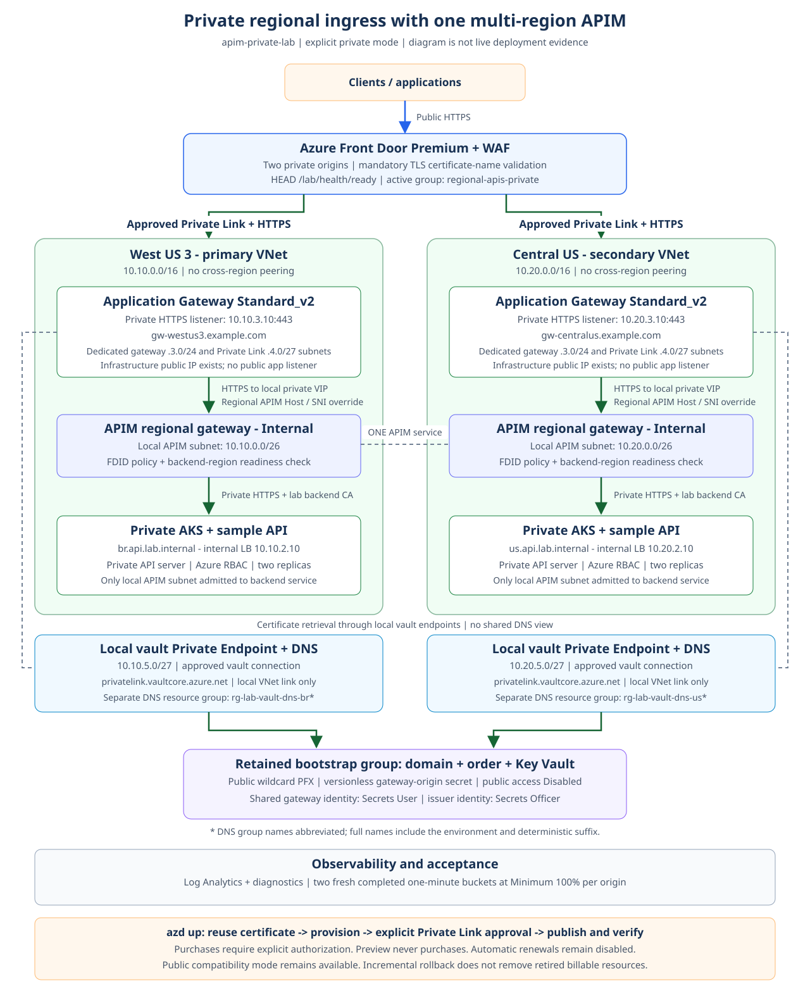
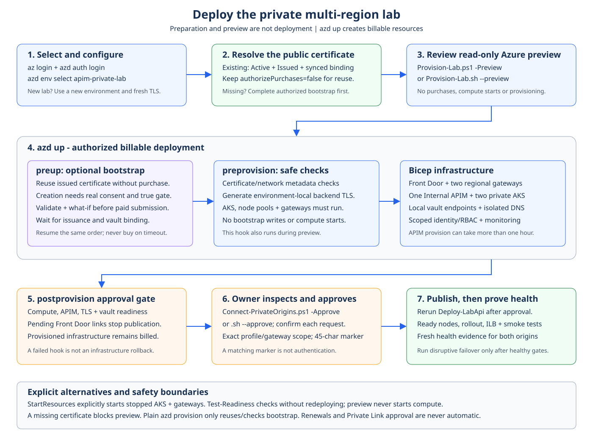
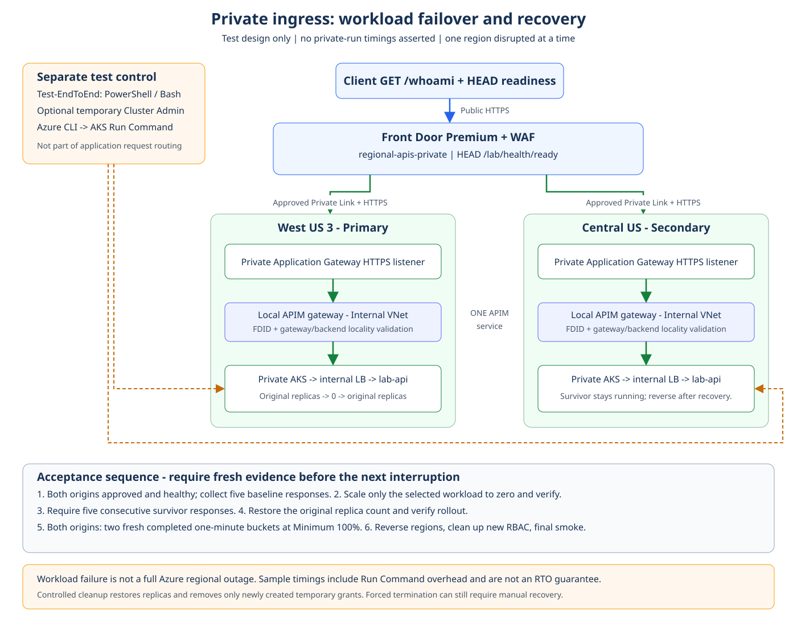

# Private multi-region API lab: Front Door, Application Gateway, APIM, and AKS

Infrastructure as code with **Azure Developer CLI (azd) + Bicep** for one
classic Premium APIM service with two regional gateways and two private AKS
clusters. The current documented environment is **`apim-private-lab`**, using
**West US 3 + Central US**, private regional ingress, and private Key Vault
access. It reuses a separately purchased public wildcard certificate.

**Compatibility boundary:** the Bicep default remains `public`; the current
private model requires explicit environment settings. Updating documentation
does not change defaults or migrate an existing deployment. This is a lab,
not a production blueprint.

## Public repository usage

Start a new deployment with [prerequisites](#1-prerequisites) and
[environment configuration](#2-configure-the-environment). The prepared-environment
quick start is only for a deployment you already own. Environment names are
examples; published domain, certificate-order, and vault identifiers are
anonymized. `example.com` and its subdomains are documentation placeholders:
use a domain you own and an issued certificate for a real deployment.

Publishing or cloning this repository does not grant access to an existing
Azure environment. The sample API is intentionally anonymous; do not serve
sensitive data with it or advertise an unattended, billable lab endpoint.
Before sharing a deployment, review authentication, abuse controls, and the
[cost and lab limitations](#lab-costs-and-limitations).

See the [MIT license](LICENSE), [contribution guide](CONTRIBUTING.md), and
[security reporting policy](SECURITY.md). Keep environment files, private keys,
registrant contacts, and raw deployment output out of commits, issues, and
workflow artifacts.

## Current architecture: private regional ingress



```text
Clients -> Front Door Premium + WAF
               | Approved Private Link + HTTPS
               +-> West US 3 Application Gateway -> Internal APIM -> local private AKS
               +-> Central US Application Gateway -> Internal APIM -> local private AKS
                                                     ONE APIM Premium service

Each gateway -> local vault Private Endpoint + isolated DNS -> shared private Key Vault
Separate bootstrap resource group -> domain + public wildcard order + vault binding
```

The two regional VNets are not peered. Front Door is the public client entry
point; regional application listeners are private. APIM is VNet-injected in
Internal mode, not exposed through a direct APIM Private Endpoint.
Gateway infrastructure public IPs and AKS outbound connectivity still exist.
The custom domain certifies the gateway origins; clients use Front Door's
managed `https://...azurefd.net` endpoint unless separately configured.

### Documentation map

| Topic | Where to start |
|---|---|
| Current architecture and exports | [Diagram catalog](diagrams/README.md) |
| Existing prepared environment | [Quick start](#quick-start-existing-prepared-private-environment) |
| New environment and dependencies | [Sections 1-2](#1-prerequisites) |
| Offline checks and Azure preview | [Section 3](#3-validate-without-creating-resources) |
| Provision, approve, and publish | [Section 4](#4-provision-and-publish-the-sample-api) |
| Health and failover acceptance | [Sections 5-6](#5-query-the-api) |
| Private vault, rollback, and cleanup | [Section 9](#9-opt-in-private-ingress) |
| Optional paid bootstrap and reuse | [Section 10](#10-optional-paid-domain-and-certificate-bootstrap) |

### Quick start: existing prepared private environment

Use this path only when the environment and certificate references already
exist. Do not run `azd env new` again or copy another environment's `.env`.
Run from the project root in PowerShell:

```powershell
az login
azd auth login
azd env select apim-private-lab
# Inspect the selected subscription and non-secret settings individually.
azd env get-value AZURE_SUBSCRIPTION_ID
azd env get-value APP_INGRESS_MODE
azd env get-value APP_GATEWAY_KEY_VAULT_NETWORK_MODE

# Read-only Azure preview; does not purchase or start AKS clusters.
pwsh -File .\scripts\powershell\Provision-Lab.ps1 -Preview

# Billable operation: reuse the certificate, provision, then attempt publication.
azd up
```

Keep the protected bootstrap file's `authorizePurchases=false` when reusing the
existing issued certificate. Do not print that file or the entire environment.
If the first postprovision hook stops **specifically because Front Door
Private Link is pending**, inspect and approve the intended requests:

```powershell
pwsh -File .\scripts\powershell\Connect-PrivateOrigins.ps1 -Approve
pwsh -File .\scripts\powershell\Deploy-LabApi.ps1
pwsh -File .\scripts\powershell\Test-Origins.ps1
pwsh -File .\scripts\powershell\Test-Lab.ps1 -Samples 20
```

The approval helper asks for confirmation per connection. A failed hook does
not undo provisioned resources or stop charges. Investigate other errors before
continuing. If existing AKS clusters or gateways are stopped, use the explicit-start
`Provision-Lab` wrapper described in section 4 instead of direct `azd up`.
For an initial paid purchase, complete section 10 first; a preview cannot
bootstrap a missing or pending certificate.

### Validation status and evidence boundaries

| Evidence | What it establishes | What it does not establish |
|---|---|---|
| November 4, 2026 private-model preview | Azure accepted the corrected Private Link marker and generated a preview | Applied resources, runtime connectivity, or private failover |
| November 5, 2026 live recovery | Both stopped Application Gateways were started; both APIM backends were Healthy; GET/HEAD readiness and 20 API samples passed across both regions | A completed strict per-origin metric gate or a private failover run |
| November 5, 2026 readiness revalidation | Both AKS/gateways Running/Succeeded, actual nodes/workloads ready, vault/certificate/Private Link gates passed; another 20 API samples and GET/HEAD passed; both origins passed fresh Minimum 100% evidence through the 13:40 UTC completed bucket | Private failover, an explanation of the earlier metric delay, or permanent health |
| November 5, 2026 bounded k6 run | 2 VUs for 60 seconds; 73 HTTP 200 responses across both regions; 219/219 checks; p95 1114.64 ms and p99 approximately 1.36 seconds; no sampled HTTP or response-validity errors | Production capacity, availability during disruption, or permanent latency guarantees |
| November 5, 2026 private-path failover runs | Observed transitions in both directions; 2 sampled timeouts stopping West US 3 and 8 stopping Central US; original two replicas restored; fresh strict origin recovery and smoke checks passed after each run | Impact-free failover, an actual Azure regional outage, exact RTO, or all-client recovery |
| Local Bicep/script and cross-shell tests | Offline contracts and topology checks passed | Azure capacity, live permissions, or data-plane health |
| Existing paid certificate observation | Domain active, wildcard issued, exact vault binding synchronized | Gateway retrieval or future renewal |
| November 3, 2026 public-mode failover | Historical public-origin workload test | Results for the new private path |

The private path has live API, gateway-backend and fresh regional metric
evidence. The earlier revalidation's 20 client samples all selected Central US; the
independent per-origin metric gate established current health in both regions.
The later private failover runs are documented under
[measured private-path failover](#measured-private-path-failover).
Do not treat successful client samples alone as proof that all Front Door
origins are healthy.

On November 5, the AKS clusters were Running and workloads had rolled out,
but both Application Gateways were `Stopped/Succeeded`, causing HTTP 504.
Starting those existing gateways restored API responses without a redeployment,
new purchases or changes to Private Link approvals. Gateway access logs after
the recovery boundary (`2026-11-05T12:59:31Z`) showed successful HTTP 200
`Edge Health Probe` readiness requests in both regions. The separate Azure
Monitor check had not established two fresh completed buckets at Minimum
100% during that initial validation window. A later read-only revalidation
passed the unchanged strict gate for both origins, through the completed
13:40 UTC bucket. No reporting-delay root cause was established and the
acceptance threshold was not relaxed.

## Compatibility architecture: public origins

[Public-mode diagram](diagrams/public-origins.svg). This remains the template
default for backward compatibility, not the current private environment's path.

```text
Clients -> Front Door Premium + WAF
               | HTTPS to restricted public origins
               +-> Brazil APIM gateway -> private HTTPS -> API on Brazil AKS
               +-> US APIM gateway     -> private HTTPS -> API on US AKS
                   \_____ ONE classic Premium instance _____/
```

- Default regions: `brazilsouth` and `eastus`. No peering between the VNets.
- Classic APIM Premium: **one unit in each region**, external VNet mode,
  a single API/policy publication, and private regional backends.
- Front Door Premium with a managed HTTPS domain at `*.azurefd.net`, WAF in
  Prevention mode with Microsoft Default Rule Set 2.1, two regional origins
  with equal priority, a `/*` route for new APIs without changing Front Door,
  no caching, and `HEAD /lab/health/ready` probes every 30 seconds.
- Two VNets, NSGs, APIM public IP addresses, and regional private DNS zones.
- Two private AKS clusters with Entra/Azure RBAC, managed identities, disabled
  local accounts, two `Standard_D2s_v4` nodes per cluster, and two API replicas.
- A stateless sample API using non-root NGINX, HTTPS, region/cluster/pod
  identification, and TLS validated by APIM.
- Log Analytics with 30-day retention and a 1 GB daily ingestion cap;
  diagnostics for APIM, Front Door, and the AKS API servers.

**In the default public mode, there is no Private Link between Front Door and APIM.** The APIM endpoint is
public, but its NSG allows HTTPS from `AzureFrontDoor.Backend`, and the policies
validate the created profile's `X-Azure-FDID`. The `AzureTrafficManager` exception
preserves the platform probes required for multi-region deployment. Management
port 3443 is restricted to the `ApiManagement` service tag; probe port 6390 is
restricted to `AzureLoadBalancer`.

In public mode, there are no load balancers or proxies **between Front Door and APIM**. The
Kubernetes Service creates an **internal Load Balancer for the AKS APIs**,
which is still required. AKS also uses public IP/load-balancing infrastructure
for **outbound traffic**. Private clusters do not mean there is no public
egress: the platform and nodes need access to dependencies and must download
the sample image.

The architecture above shows the default regional configuration. The real
`apim-west-lab` test used **West US 3 and Central US** because of subscription
SKU restrictions. Its diagram and results appear in section 6. Resource-name
suffixes `br` and `us` remain unchanged when using different regions.

## Mode comparison

The current environment explicitly selects the implemented private design.
The diagrams describe configuration, not proof of live deployment.

| Setting | Default `public` | Opt-in `private` |
|---|---|---|
| Front Door and WAF | Premium, enabled | Premium, enabled |
| Front Door origins | Restricted APIM public endpoints | Regional Application Gateways over Private Link |
| APIM VNet mode | External | Internal |
| Regional application ingress | APIM public gateway | Private Application Gateway HTTPS listener |
| Listener certificates | APIM managed certificates | Reused or explicitly purchase-gated public certificate in Key Vault |
| Gateway vault access | Not required | Regional Private Endpoints and isolated DNS in the current model |
| Origin group | `regional-apis` | `regional-apis-private` |
| New chargeable resources | None | Two Standard_v2 gateways, identities, IPs, Private Link, and logs |

APIM remains **one classic Premium service with two regional gateways**.
The `X-Azure-FDID` policy is retained, but this header is **not a secret or
cryptographic credential**; it complements network isolation and does not
replace it. There is no direct Private Endpoint on the VNet-injected APIM.

## Lab costs and limitations

**Significant costs apply even without requests:** two classic APIM Premium
units, Front Door Premium, four AKS node VMs, disks, IP addresses, load balancers,
and logs. Do not replace APIM with Developer/Standard to save money: that would
not test native multi-region deployment. Use the
[Pricing Calculator](https://azure.microsoft.com/pricing/calculator/) with your
subscription's rates. The daily log cap neither limits the solution's total
cost nor guarantees observability throughout the day. Private ingress adds
**two Application Gateway Standard_v2 resources, each with a minimum of two
instances**, plus related Private Link, IP, certificate-vault, and logging
charges. Keeping WAF on Front Door avoids adding a second regional WAF tier.

The main lab does not create databases, data replication, queues, client custom
domains, consumer identities, or business authentication. It references
user-supplied domain names and certificates; the separate, purchase-gated
[domain bootstrap](#10-optional-paid-domain-and-certificate-bootstrap) can
register a domain and order a public certificate. The `/lab` API is
**anonymous through Front Door**, for demonstration only, with no sensitive
data. The failover test simulates a workload failure, not an actual Azure
regional outage. There are no guarantees for SLA, RTO/RPO, or production
capacity. APIM/AKS are not configured for availability-zone distribution.

## 1. Prerequisites

- `azd`, Azure CLI (`az`), and Bicep CLI (`bicep`) on PATH, plus either
  PowerShell **7.4+** or the Bash dependencies described in section 2.
- **Python 3.9+** is required in both shells for the shared readiness engine
  and, when configured, the optional domain/certificate bootstrap. Both use
  only the standard library.
- For the current private path: an owned public domain, an issued public
  wildcard certificate and synchronized Key Vault binding, or the explicitly
  authorized bootstrap in section 10. The private-only vault must have Azure
  RBAC and use the explicit `private-endpoints` network mode.
- An active subscription, quota for at least **4 DSv4-family vCPUs per region**
  with the default configuration, and APIM Premium/AKS availability in both
  regions. SKU availability does not guarantee physical capacity.
- Permissions to create resource groups/resources and assign roles
  (for example, Contributor + Role Based Access Control Administrator at the
  appropriate scope). The AKS identity receives Network Contributor only
  on its local VNet.
- The account needs these AKS actions:
  `Microsoft.ContainerService/managedClusters/runcommand/action` and
  `Microsoft.ContainerService/managedClusters/commandResults/read`.
- The Azure CLI identity also needs Kubernetes authorization in both AKS
  clusters. For this lab's bootstrap, the
  `Azure Kubernetes Service RBAC Cluster Admin` role at each cluster's scope
  allows namespace creation and manifest application. `Owner`/`Contributor`
  do not replace Kubernetes data-plane permissions;
  `Azure Kubernetes Service RBAC Admin` does not allow namespace creation.
  Remove temporary assignments after use. Propagation can take up to five
  minutes. Subsequent deployments and tests through Run Command also require
  appropriate Kubernetes access.
- To manage persistent bootstrap access through Bicep, set
  `AKS_ADMIN_PRINCIPAL_ID` to the Entra **user object ID** (not the UPN or an
  application/client ID). Bicep assigns AKS RBAC Cluster Admin to that user
  separately on each cluster, never at resource-group or subscription scope.
  Leave it unset to create no user assignments. These assignments have no
  automatic expiration; review and revoke them explicitly when no longer needed.
- Deployment verification and failover tests also require
  `Microsoft.Insights/metrics/read` on the Front Door profile (for example,
  Monitoring Reader at that scope). Temporary AKS Cluster Admin does not grant
  this permission. Azure CLI/metric errors fail explicitly; missing telemetry
  is never interpreted as a healthy origin.
- Registered providers: `Microsoft.ApiManagement`, `Microsoft.Cdn`,
  `Microsoft.Network`, `Microsoft.ContainerService`, `Microsoft.Compute`,
  `Microsoft.ManagedIdentity`, `Microsoft.OperationalInsights`,
  `Microsoft.Insights`, and `Microsoft.Storage`. Check organizational policies
  and limits before provisioning.
- Internet access to Azure, `azurefd.net`, and image downloads from AKS.
  The lab uses `nginxinc/nginx-unprivileged:1.28-alpine`; for production,
  mirror it to ACR and pin an approved digest.

You do not need to install Docker, build an image, or expose the AKS API server.
The postprovision hook uses **AKS Run Command** to apply manifests to the private
clusters. This feature has scheduling/time/output limits and elevated
permissions; it is a testing convenience, not a replacement for a production
pipeline with private connectivity and dedicated RBAC.

## 2. Configure the environment

### Script folders and shell requirements

Equivalent entrypoints are separated by shell. Readiness uses one shared
Python engine to prevent PowerShell/Bash state-machine drift:

| Workflow | PowerShell | Bash |
|---|---|---|
| Shared helpers | `scripts/powershell/Lab.Common.ps1` | `scripts/bash/Lab.Common.sh` |
| Prepare configuration and TLS | `scripts/powershell/Prepare-Lab.ps1` | `scripts/bash/Prepare-Lab.sh` |
| Reuse / explicitly bootstrap domain and certificate | `scripts/powershell/Sync-DomainBootstrap.ps1` | `scripts/bash/Sync-DomainBootstrap.sh` |
| Provision; optionally start existing compute | `scripts/powershell/Provision-Lab.ps1` | `scripts/bash/Provision-Lab.sh` |
| Check readiness; explicitly start stopped compute | `scripts/powershell/Test-Readiness.ps1` | `scripts/bash/Test-Readiness.sh` |
| Publish workloads | `scripts/powershell/Deploy-LabApi.ps1` | `scripts/bash/Deploy-LabApi.sh` |
| Smoke test | `scripts/powershell/Test-Lab.ps1` | `scripts/bash/Test-Lab.sh` |
| Regional origin health | `scripts/powershell/Test-Origins.ps1` | `scripts/bash/Test-Origins.sh` |
| Check / explicitly approve private origins | `scripts/powershell/Connect-PrivateOrigins.ps1` | `scripts/bash/Connect-PrivateOrigins.sh` |
| Single-region failure test | `scripts/powershell/Test-Failover.ps1` | `scripts/bash/Test-Failover.sh` |
| Bounded k6 load test | `scripts/powershell/Test-Load.ps1` | `scripts/bash/Test-Load.sh` |
| Complete test workflow | `scripts/powershell/Test-EndToEnd.ps1` | `scripts/bash/Test-EndToEnd.sh` |

PowerShell requires **7.4 or newer** and **Python 3.9+**. Bash requires **4.4 or newer**, **Python
3.9 or newer** (standard library only), **OpenSSL 1.1.1 or newer**, and **curl**,
in addition to `az` and `azd`. Bash does not invoke PowerShell. Use Linux,
WSL, or macOS with an updated Bash (the macOS system Bash 3.2 is too old).
In WSL, install and authenticate the Linux versions of both Azure CLIs.
Run scripts from the project root using `bash`; executable file permissions
are not required.

The azd hooks select PowerShell on Windows and Bash on POSIX systems
automatically. Both implementations read the selected azd environment and
share the same TLS files, manifests, resources, and test contracts.

From the project root:

```powershell
az login
azd auth login
azd env new apim-private-lab --subscription "<your-subscription-id>" --location westus3 --no-prompt
azd env set AZURE_SECONDARY_LOCATION centralus
azd env set APIM_PUBLISHER_EMAIL "<your-valid-email>"
azd env set APIM_PUBLISHER_NAME "APIM Lab"
azd env set APP_INGRESS_MODE private
azd env set APP_GATEWAY_KEY_VAULT_NETWORK_MODE private-endpoints
```

For an already prepared environment, use `azd env select apim-private-lab`
instead. Before preview/provision, configure the existing vault, versionless
secret URI, issued certificate-order ID and domain settings in section 9, or
the optional bootstrap resolver in section 10. Selecting private mode alone
does not supply a certificate. Both regions must be configured explicitly:
the template defaults remain `brazilsouth` / `eastus`.

Use an environment name with 3-24 characters, starting with a letter, using
lowercase letters, digits, or hyphens. The selected subscription is the one
you provide; subscription/tenant IDs are not embedded in the infrastructure
files.

### Persistent Kubernetes access managed by Bicep

Configure the user before running `azd provision` (the same commands work in
PowerShell and Bash):

```text
azd env set AKS_ADMIN_PRINCIPAL_ID "<user-object-id>"
```

For new assignments, Bicep generates stable GUIDs from the cluster, user, and
role. If that user already has a direct Cluster Admin assignment on a cluster,
adopt its existing assignment GUID to avoid `RoleAssignmentExists`:

```text
azd env set AKS_PRIMARY_ADMIN_ROLE_ASSIGNMENT_NAME "<existing-primary-assignment-guid>"
azd env set AKS_SECONDARY_ADMIN_ROLE_ASSIGNMENT_NAME "<existing-secondary-assignment-guid>"
```

Keep these adoption values in the environment for subsequent deployments.
Do not reuse them for another user or environment: role assignment GUIDs
cannot be reassigned to another principal or scope. A fresh environment leaves
both adoption values unset; do not copy assignments from the deleted lab.

The provisioning identity needs `Microsoft.Authorization/roleAssignments/write`
at both cluster scopes. Creating an assignment does not bypass propagation:
allow up to five minutes before retrying workload publication if a new grant
is not yet effective. Clearing the principal ID only stops managing/creating
the assignments; incremental deployments do not revoke existing access.
Explicitly delete the assignments to revoke it. The optional temporary-access
test workflow preserves pre-existing persistent assignments.

To change the node count, add the ARM parameter `aksNodeCount` (integer,
default 2) to `infra/main.parameters.json`. To change the VM size, edit
`aksVmSize`, configured in that file as `Standard_D2s_v4`. The Bicep default
remains `Standard_D2s_v5` when this parameter is omitted. Check SKU restrictions
and quota in both regions before provisioning. APIM capacity is deliberately
fixed at one unit per region for this test.

## 3. Validate without creating resources

### Offline CI

[Offline validation](.github/workflows/validate.yml) runs on pushes, pull
requests and manual dispatch, on Ubuntu 24.04 and Windows Server 2022.
It compiles Bicep, parses PowerShell and runs the offline Python/cross-shell
tests, including architecture links and diagram source/export checks.
It also runs the [reproducible diagram tooling](diagrams/README.md#reproduce-png-exports)
on Node.js 24 and checks that all committed PNGs match their SVG sources.
It uses Python 3.13, Bicep 0.40.2 and the pinned validation dependencies in
[tests/requirements.txt](tests/requirements.txt). Actions are pinned by commit,
the token has only `contents: read`, and checkout credentials are not persisted.
JUnit XML reports and the PowerShell validation log are retained for 14 days
as per-OS workflow artifacts, including failed runs. Assertions normalize
PowerShell diagnostic color/line wrapping instead of depending on terminal width.
[Dependabot](.github/dependabot.yml) proposes weekly updates for Actions and
validation dependencies; updates still require review and passing CI.
The [secret-scanning workflow](.github/workflows/secret-scan.yml) runs a
checksum-pinned Gitleaks binary against full Git history on every push and pull
request. Findings are redacted and fail the job. The scanner runs on the GitHub
runner without an external scanning service or license key.

The workflow does not authenticate to Azure, provision infrastructure or use
Azure secrets. It downloads validation tools/packages but Azure behavior in
tests is mocked. GitHub-hosted runner minutes can consume the private
repository's included allowance; this is not a promise of free CI.
No Azure cloud-readiness or failover result is established by CI.
The workflow starts on GitHub only after these files are committed and pushed.

To install the same test dependency locally:

```powershell
python -m pip install -r .\tests\requirements.txt
```

```powershell
pwsh -File .\tests\Test-Local.ps1
```

The test compiles Bicep, verifies the topology, parses PowerShell/JSON/XML,
generates temporary certificates, validates the TLS chain, renders manifests,
and tests AKS Run Command error propagation. It does not query the subscription.

For additional YAML tests, if Python + PyYAML are already available:

```powershell
python .\tests\test_workload.py
```

For offline private-ingress gates and PowerShell/Bash parity, with both shells
and their documented dependencies installed:

```powershell
python -m unittest discover -s .\tests -p test_private_ingress.py
python -m unittest discover -s .\tests -p test_readiness.py
python -m unittest discover -s .\tests -p test_domain_bootstrap.py
python -m unittest discover -s .\tests -p test_reliability.py
python -m unittest discover -s .\tests -p test_bash.py
python -m unittest discover -s .\tests -p test_documentation.py
python -m unittest discover -s .\tests -p test_alerts.py
python -m unittest discover -s .\tests -p test_readiness_shells.py
```

These simulate Azure calls; they do not prove Azure deployment readiness,
certificate availability, live Private Link connectivity, or failover.

With both CLIs authenticated and the values from step 2 configured:

```powershell
pwsh -File .\scripts\powershell\Provision-Lab.ps1 -Preview
```

For Bash, use `bash scripts/bash/Provision-Lab.sh --preview`.
The authentication and `azd env` configuration commands above work in both shells.

Preparation checks authentication, generates local TLS material, and verifies
that existing environment AKS clusters and private-ingress Application Gateways
are `Running/Succeeded`, including AKS node-pool state and capacity. Preparation
without an explicit startup flag and the azd hooks **never start resources**.
A stopped or transitioning resource causes an actionable error instead.
The preview
queries Azure but does not provision infrastructure. It requires permissions
and might not detect every quota/capacity limitation or configuration error
that is only validated at runtime.

## 4. Provision and publish the sample API



### First deployment: azd up

**This command incurs charges.** After configuring section 2 and completing
the certificate prerequisites and preview, run:

```powershell
azd up
```

The same command works in Bash. There are no azd application services to build:
hooks orchestrate the infrastructure and sample workload publication.

| Stage | Behavior |
|---|---|
| `preup` | Optional bootstrap: reuse/resume the existing order; creating a new order requires the purchase gate |
| `preprovision` | Validate configuration, resolve existing certificate references, generate backend TLS locally, and check existing AKS/node-pool and gateway runtime state; no bootstrap cloud mutations or compute starts |
| Bicep provision | Deploy private ingress, APIM/AKS, vault network access, identity/RBAC, and monitoring |
| `postprovision` | Check compute, APIM, Front Door routing, gateway backend health, certificate, vault networking and Private Link before applying workloads; then verify nodes, replicas, service endpoints, ILB and fresh global/origin health |

The first publication normally stops until the owner approves Front Door's
Private Link requests. This is an intentional gate, not a reason to delete
or repurchase resources. Inspect each intended connection before confirmation:

```powershell
pwsh -File .\scripts\powershell\Connect-PrivateOrigins.ps1 -Approve
pwsh -File .\scripts\powershell\Deploy-LabApi.ps1
pwsh -File .\scripts\powershell\Test-Origins.ps1
pwsh -File .\scripts\powershell\Test-Lab.ps1 -Samples 20
```

```bash
bash scripts/bash/Connect-PrivateOrigins.sh --approve
bash scripts/bash/Deploy-LabApi.sh
bash scripts/bash/Test-Origins.sh
bash scripts/bash/Test-Lab.sh --samples 20
```

Only continue this recovery sequence for a verified pending-approval gate.
For a different error, inspect the failed operation first.

### Existing or stopped resources: explicit startup

All readiness checks, publishers and normal test commands are **read-only
with respect to resource power state**. A stopped gateway is not healthy
merely because provisioning succeeded or Private Link was approved.
`Provision-Lab` no longer implicitly starts AKS: startup now requires the
explicit `-StartResources` / `--start-resources` flag.

To start existing stopped lab AKS and private-ingress gateways **and provision**:

```powershell
pwsh -File .\scripts\powershell\Provision-Lab.ps1 -StartResources
```

For Bash:

```bash
bash scripts/bash/Provision-Lab.sh --start-resources
```

The wrapper runs the optional purchase-gated bootstrap, prepares configuration
and TLS, and discovers existing compute in the selected subscription using
the `azd-env-name` tag. It refuses ambiguous counts/regions, duplicate IDs,
multiple resource groups, wrong tags or scopes. A new environment with no
matching compute is valid during preparation; Bicep creates the resources.
Publication and tests require both regions and their exact deployment outputs.

Start requests use `--no-wait`; all eligible stopped AKS/gateways receive a
request before polling. Already running resources are unchanged. Existing
supported transitions are awaited without duplicate starts; a resource that
finishes stopping can then be started. Failed/unknown states and CLI errors
stop the workflow rather than guessing or restarting blindly. Public mode
does not start retained, unused private-ingress gateways.

The startup timeout defaults to 1,800 seconds (30 minutes), with a configurable
range of 30 to 7,200 seconds:

```powershell
pwsh -File .\scripts\powershell\Provision-Lab.ps1 -StartResources -WaitSeconds 3600
```

```bash
bash scripts/bash/Provision-Lab.sh --start-resources --wait-seconds 3600
```

A timeout or later provisioning failure does not stop resources again or cancel
Azure start operations already submitted. Inspect the state before retrying.
Starting resources resumes charges and may fail if Azure lacks capacity.
The CLI identity needs resource discovery/read access in the subscription and
`Microsoft.ContainerService/managedClusters/start/action` on both clusters;
Kubernetes RBAC Cluster Admin alone does not grant management-plane startup.
Gateway startup also requires
`Microsoft.Network/applicationGateways/start/action` on the exact gateways.

For a preview that never starts resources, use:

```powershell
pwsh -File .\scripts\powershell\Provision-Lab.ps1 -Preview
```

```bash
bash scripts/bash/Provision-Lab.sh --preview
```

The installed azd version does not provide a reliable preview indicator to
these hooks. Therefore the wrapper, rather than an unconditional hook action,
owns startup. Direct `azd provision`, `azd up`, and `azd provision --preview`
retain the read-only compute guard: stopped resources fail with guidance
instead of silently resuming charges. Preview ignores `StartResources`
even if both flags are supplied. To prepare/start without provisioning, use
`Prepare-Lab.ps1 -StartResources` or `Prepare-Lab.sh --start-resources`.
The legacy `StartClusters` flag starts AKS only and still refuses stopped
gateways; prefer `StartResources`. Preview still queries Azure and can fail
validation for stopped resources.

This is an infrastructure-only project, with no azd build/deploy services.
The `preprovision` hook checks configuration/authentication, prepares TLS, and
verifies existing compute is running without changing its power state.

### Readiness before publication and testing

Run the complete, non-disruptive prerequisite check after workloads are published:

```powershell
pwsh -File .\scripts\powershell\Test-Readiness.ps1
pwsh -File .\scripts\powershell\Test-Lab.ps1 -Samples 20 -WaitSeconds 300
pwsh -File .\scripts\powershell\Test-Origins.ps1
```

```bash
bash scripts/bash/Test-Readiness.sh
bash scripts/bash/Test-Lab.sh --samples 20 --wait-seconds 300
bash scripts/bash/Test-Origins.sh
```

To explicitly start existing compute **without redeploying infrastructure**,
use `Test-Readiness.ps1 -Stage Infrastructure -StartResources -WaitSeconds 3600`
or `Test-Readiness.sh --stage Infrastructure --start-resources --wait-seconds 3600`.
Use `-Stage Infrastructure` / `--stage Infrastructure` before first publication:
it does not require the sample workload to exist.

#### Progress and machine-readable reports

Console output identifies each active phase (`START`), result and elapsed
seconds. Certificate, private vault DNS/endpoints and Private Link approval
checks each announce their phase before querying Azure; a quiet provider call
can still take several minutes. Progress does not mean a check has passed.

Both standalone readiness entrypoints support a JSON mode:

```powershell
pwsh -File .\scripts\powershell\Test-Readiness.ps1 -Json > readiness.json
if ($LASTEXITCODE -ne 0) { throw 'Readiness failed; inspect readiness.json and stderr.' }
$report = Get-Content .\readiness.json -Raw | ConvertFrom-Json
$report.checks | Format-Table name, status, durationSeconds
```

```bash
bash scripts/bash/Test-Readiness.sh --json > readiness.json
# Inspect the exit code before consuming status: passed; stderr carries progress.
```

For valid CLI arguments and installed prerequisites, stdout is one JSON object
on success **or validation failure**; progress/provider diagnostics go to
stderr. A failed gate returns exit code 1 and `status: failed`, rather than a
success-shaped fallback. The report includes `schemaVersion: 1`, stage,
UTC start/end timestamps, total seconds, per-check timings/status/errors, and
the evidence boundary. A private-mode report includes the existing certificate,
vault-network and exact Private Link gates; an earlier failure leaves later
checks unexecuted, not implicitly passed. Environment values, tokens, private
keys and provider raw responses are not serialized into the JSON report.
Invalid arguments or missing shell/Python dependencies can fail before a
report is created. JSON mode does not imply startup: `StartResources` remains
a separate explicit, billable opt-in.

| Readiness layer | Required evidence |
|---|---|
| Management scope | Enabled selected subscription; exact environment, resource IDs, tags and regional mapping |
| AKS compute | Both clusters and all configured node pools Running/Succeeded, with System capacity |
| Private ingress compute | Both gateways **operationally Running**, not just provisioned |
| APIM / Front Door | Correct APIM network mode/regions/VIPs; enabled HTTPS route and both origins; expected HEAD readiness probe; TLS name validation enabled |
| Gateway backend | Native `show-backend-health` returns nonempty Healthy evidence for the correct regional APIM VIP; empty/unknown evidence fails |
| Certificate and private access | Existing certificate issuance/coverage/validity and vault binding, actual isolated vault endpoint/DNS topology and exact Private Link approval; no purchases or automatic approvals |
| Workloads (default standalone stage) | AKS Run Command reads actual Ready/schedulable nodes; current fully ready rollout, positive replicas, exact internal HTTPS LB address and ready EndpointSlice targets for every replica |
| Runtime acceptance (separate tests) | GET/HEAD readiness and locality checks, then two fresh completed one-minute regional buckets at **Minimum 100%** |

The publisher checks Infrastructure before applying manifests and Workloads
after rollout. Smoke/origin tests repeat Infrastructure checks before HTTP or
metric polling; they do not require new Kubernetes admin permissions just to
query API/metric health. Disruptive tests also check Workloads before scaling
anything. No workload-health guard runs while an intentional failure is active,
and restoration/temporary-role cleanup is never blocked by a new preflight.
`WhatIf` returns before readiness, startup, role changes or workload mutation.

These are staged checks, not an atomic guarantee against resources stopping
after inspection. Kubernetes readiness uses read-only `kubectl get` commands
through AKS Run Command (which creates a transient execution pod); it does not
deploy/restart application pods. Infrastructure diagnostics need resource read
access and `Microsoft.Network/applicationGateways/backendhealth/action` on
the gateways; this diagnostic action does not start or reconfigure them.
The CLI identity also needs AKS Run Command rights
and Kubernetes read access to nodes, deployments, services and EndpointSlices.
For disruptive testing it also needs the existing scale/watch permissions;
optional temporary Cluster Admin grants are still separately authorized.

Readiness success never substitutes for live API/TLS or strict metric evidence.
If HTTP requests fail after preflight, inspect DNS, TLS, gateway probe details,
APIM logs and backend health rather than assuming ordinary propagation.
The earlier Front Door metric discrepancy did not justify weakening the gate.
The subsequent November 5 revalidation passed it unchanged; future runs must
still establish fresh evidence rather than reusing that historical result.
Bicep creates the resources; the `postprovision` hook publishes the same API to
both AKS clusters through Run Command, waits for the internal IP addresses,
and runs global smoke and per-origin health checks. APIM receives the OpenAPI definition **once**, and
the service propagates it to both gateways.

Creating or updating multi-region APIM can take **more than an hour**.
Front Door and policies also need time to propagate. The smoke test waits
up to 20 minutes after publishing the workloads; inspect the logs if it times
out. A failed hook does not roll back provisioned resources or stop charges.
Origin verification can take another 15 minutes while Azure Monitor ingests
new evidence. It requires completed metric buckets from after both workload
deployments, not pre-deployment healthy samples.

### Troubleshooting deployment gates

| Symptom | Action |
|---|---|
| `AfdOrigin.SharedPrivateLinkResource.RequestMessage` / `MaxLengthExceeded` | Use the current routing template and matching approval helpers. New markers are `apim-lab:` plus ARM `guid(toLower(profile.id))`, exactly 45 characters, below the 140-character limit. Rerun preview; shortening environment names is not required. |
| Preview cannot find an issued certificate | Preview is intentionally read-only. Reuse an existing synchronized certificate or complete the explicitly authorized bootstrap in section 10 before retrying. |
| Existing AKS/gateways stopped or transitioning | Direct azd hooks and tests never start compute. Use the explicit `StartResources` option and inspect failed operations before retrying. |
| AKS rollouts pass but Front Door returns HTTP 504 | Check each Application Gateway's **operationalState**, not just `provisioningState`. A stopped gateway can still report `Succeeded` and have approved Private Link and valid vault networking. Start the existing stopped gateways with explicit cost authorization, then verify backend health, API responses and fresh per-origin metrics. |
| Postprovision reports pending Front Door Private Link | Inspect/approve the exact expected requests, then rerun the publisher; do not blindly rerun purchases. |
| Private origin status stays null after approval | The Front Door status projection can remain empty even when the exact gateway connection is `Succeeded/Approved`. Helpers accept `ApprovedAtGateway` only after verifying a unique scoped connection, successful enabled origin, exact Host/region/request marker, and TLS configuration. They emit an explicit evidence-source warning. This passes only the approval gate, not runtime health. An explicit Front Door `Pending`, `Rejected` or `Disconnected` is never overridden. |
| Vault endpoint/DNS/RBAC check fails | Keep vault public access Disabled. Check both local endpoint approvals, isolated DNS views, exact secret reference, and scoped Secrets User propagation. |
| Origin health is missing, stale, or unhealthy | Wait for fresh completed metric buckets and investigate DNS/TLS/backend readiness. Never disable certificate validation or substitute old public-origin evidence. |

#### Recover stopped Application Gateways

The AKS startup options do **not** start Application Gateway. A successful
vault/Private Link check is not a gateway power-state or API health check.
The smoke test's generic "propagation" warning reports the HTTP response;
it does not establish propagation as the cause of a 504.

Inspect the existing gateways without changing them:

```powershell
$gatewayIds = @(
    (azd env get-value APP_GATEWAY_PRIMARY_ID).Trim()
    (azd env get-value APP_GATEWAY_SECONDARY_ID).Trim()
)
foreach ($gatewayId in $gatewayIds) {
    az network application-gateway show --ids $gatewayId `
        --query "{name:name,operationalState:operationalState,provisioningState:provisioningState}" `
        --output table
}
```

Only when the gateways are confirmed stopped and you authorize resuming their
normal running charges, start them:

```powershell
foreach ($gatewayId in $gatewayIds) {
    az network application-gateway start --ids $gatewayId
    if ($LASTEXITCODE -ne 0) { throw "Gateway startup failed: $gatewayId" }
}
foreach ($gatewayId in $gatewayIds) {
    az network application-gateway show-backend-health --ids $gatewayId
    if ($LASTEXITCODE -ne 0) { throw "Gateway backend health query failed: $gatewayId" }
}
pwsh -File .\scripts\powershell\Test-Lab.ps1 -Samples 20 -WaitSeconds 300
pwsh -File .\scripts\powershell\Test-Origins.ps1
```

Require `Running/Succeeded`, healthy APIM backends, HTTP 200 readiness and
fresh metrics from **both** private origins. No new infrastructure deployment,
certificate purchase or Private Link approval is needed just to start an
already configured gateway.

Test certificates are stored in `.azure\<environment>\tls`, which Git ignores.
The public CA certificate is installed in APIM's trust store; the CA private
key is not persisted. The server certificate is valid for 60 days and covers
both private names. The server certificate/key is shared by the workloads
only to simplify this lab. **Never commit these files, and do not use this
local certificate-management approach in production.** Front Door origin TLS
and APIM certificate-chain/hostname validation remain enabled.

## 5. Query the API

```powershell
azd env get-value API_URL
# Example: https://api-<environment>-<suffix>.<hash>.azurefd.net/lab
Invoke-RestMethod "<API_URL>/whoami"
Invoke-WebRequest "<API_URL>/health/ready" -Method Head
pwsh -File .\scripts\powershell\Test-Lab.ps1 -Samples 20
```

Equivalent Bash commands:

```bash
API_URL="$(azd env get-value API_URL)"
curl --fail-with-body "$API_URL/whoami"
curl --fail --head "$API_URL/health/ready"
bash scripts/bash/Test-Lab.sh --samples 20
```

`API_URL` already includes `/lab`. Example response body:

```json
{"region":"westus3","cluster":"aks-...-br","pod":"lab-api-..."}
```

The response includes `X-Lab-Gateway-Region`. The test compares the normalized
gateway region with the application region; a mismatch is a failure.
All requests from one client may reach the lower-latency region. Active-active
does not imply a 50/50 split or prove that both origins are healthy.

### Verify both protected regional origins

```powershell
pwsh -File .\scripts\powershell\Test-Origins.ps1
```

```bash
bash scripts/bash/Test-Origins.sh
```

This queries Front Door's `OriginHealthPercentage` metric, split by `Origin`
and `OriginGroup`, for each active regional origin hostname on port 443:
APIM hosts in `regional-apis` for public mode, or Application Gateway hosts in
`regional-apis-private` for private mode. Private mode also checks the actual
Front Door Private Link configuration and approval status. Stale outputs or
public-origin evidence cannot establish private-origin health.
Each origin must have **two consecutive completed one-minute
buckets with Minimum = 100%**, with its latest bucket no more than five minutes
old. Missing/null data, stale samples, an unhealthy region, or insufficient
post-recovery evidence cannot pass.

The APIM readiness policy checks the backend's `X-Lab-Backend-Region` header
against its own gateway region for both GET and HEAD. A missing/mismatched
header changes readiness HTTP 200 to 503. Consequently, successful Front Door
probes exercise the regional APIM gateway and its local HTTPS backend, rather
than just the global endpoint. No direct-origin access, firewall exception,
temporary route, or bypass of `X-Azure-FDID` validation is introduced.

By default, the checker considers the previous five minutes and waits up to
900 seconds. Use `-WaitSeconds 0` / `--wait-seconds 0` for a single assessment.
For a fresh boundary, use `-Since "2026-11-03T18:00:00Z"` or
`--since "2026-11-03T18:00:00Z"` with a UTC timestamp appropriate to your run.
Only buckets starting at or after the first minute boundary at or after that
timestamp are eligible;
in-progress buckets and buckets overlapping the boundary are excluded.
Evidence is metric-based and subject to ingestion delay, not an instantaneous
guarantee about every edge location.
The Azure Monitor request spans at least five minutes to satisfy its minimum
query-window requirement, even immediately after a rollout. The acceptance
filter still excludes all buckets before the requested boundary; requesting
older telemetry does not allow old healthy samples to prove recovery.

To check isolation, retrieve `APIM_PRIMARY_HOST`, `APIM_SECONDARY_HOST`, and
`AZURE_FRONT_DOOR_ID` using `azd env get-value <name>`. Try accessing each host
directly, including with the correct `X-Azure-FDID` header. Outside the allowed
network, the NSG should block the connection; the header alone should not
enable a bypass. VPNs, proxies, and local policies may affect your network
observations. Also verify in Azure that the AKS Services have only internal
IP addresses.

## 6. Simulate failure and recovery

### Current private-model test design



The same test scripts support both modes. In the current private model,
health evidence must cover `regional-apis-private` and both approved gateway
origins. Test control uses AKS Run Command, not the application traffic path.
This diagram defines the test sequence and acceptance criteria; it does not
claim a completed private run or reuse historical elapsed times.

### Historical public-mode evidence

The retired `apim-west-lab` environment used **restricted public APIM origins**,
not the current private Application Gateway path. Its November 3, 2026 results
remain available as historical evidence:
[PNG](diagrams/historical-public-failover.png) |
[Vector SVG](diagrams/historical-public-failover.svg).

Do not treat that drawing, its resource names or its results as current
private-environment deployment evidence.

The historical real run on **November 3, 2026**, before the stronger acceptance
checks below were added, completed with exit code `0`:

| Simulated workload failure | Serving region | Time to five consecutive responses | Failed samples |
|---|---|---|---|
| West US 3 API stopped | Central US | 42 seconds | 0 |
| Central US API stopped | West US 3 | 102 seconds | 3 timeouts |

These elapsed times include Run Command overhead and sampling, not exact RTO.
The first case demonstrated continued service from Central US, which was
already serving the initial samples; it does not independently measure a
traffic transition. Both clusters finished with two replicas, successful
rollouts, verified removal of temporary role assignments, and a passing final
smoke test. The three timeouts show that failover was not impact-free.

### Complete workflow in one command

With the private infrastructure approved and the API already deployed, select the correct environment
and run:

```powershell
azd env select apim-private-lab
pwsh -File .\scripts\powershell\Test-EndToEnd.ps1 -TemporaryClusterAdmin
```

The environment name above is an example; use the environment you intend to
test. The script displays the environment and both clusters, then asks for
confirmation before granting permissions or disrupting workloads. It does not
provision infrastructure or publish manifests.

The workflow:

1. Verify both regional origins and metric access before granting temporary
   permissions. With `-TemporaryClusterAdmin`, identify the signed-in Azure CLI user and
   create `Azure Kubernetes Service RBAC Cluster Admin` access only on the two
   clusters when that access does not already exist. This requires
   role-assignment permissions and an interactive user login; this mode
   does not use a service principal.
2. Verify Kubernetes authorization, wait for RBAC propagation, and record
   the original replica count of both workloads.
3. Run a smoke test, `Primary` failover, and `Secondary` failover in sequence.
   Before each interruption, verify both origins and collect five baseline
   client responses. Scale the target to zero, wait for rollout, and verify
   the desired replica count is zero. Require five consecutive survivor
   responses before the failover deadline.
   Each test restores and verifies original replicas, then requires fresh
   healthy metric buckets for both origins **after restoration** before the
   next region can be stopped.
4. In `finally`, attempt to ensure both clusters have their original replica
   counts, then remove and verify removal of only the temporary assignments
   created during this execution. Existing assignments are preserved.
   Restoration or cleanup failures are reported as errors; cleanup continues
   for the other assignments.
5. Recheck both regional origins and run the final smoke test after restoration
   and permission removal.

If your identity already has sufficient Kubernetes access, omit the RBAC option:

```powershell
pwsh -File .\scripts\powershell\Test-EndToEnd.ps1
```

To preview the operation without calling the test APIs, assigning roles,
or changing replicas:

```powershell
pwsh -File .\scripts\powershell\Test-EndToEnd.ps1 -TemporaryClusterAdmin -WhatIf
```

Equivalent Bash commands:

```bash
# Requires confirmation; creates temporary roles only when needed.
bash scripts/bash/Test-EndToEnd.sh --temporary-cluster-admin

# Use existing workload permissions.
bash scripts/bash/Test-EndToEnd.sh

# Read the selected environment without Azure/API calls or mutations.
bash scripts/bash/Test-EndToEnd.sh --temporary-cluster-admin --what-if
```

Bash options map directly to PowerShell parameters: `--samples 20`,
`--timeout-seconds 600`, and `--rbac-wait-seconds 600`. Use `--yes` only when
you intend to suppress disruptive-operation confirmation (equivalent to
PowerShell's `-Confirm:$false`). Temporary permissions still require the
separate `--temporary-cluster-admin` opt-in. Bash uses an `EXIT` trap for
restoration and role cleanup, including handled `INT`/`TERM` signals.
Forced termination such as `SIGKILL`, machine shutdown, or terminal loss
can still prevent cleanup.

Optional parameters: `-Samples 20` for the initial/final smoke tests,
`-TimeoutSeconds 600` for each failover, and `-RbacWaitSeconds 600` for
authorization propagation per cluster. `-OriginWaitSeconds 900` /
`--origin-wait-seconds 900` controls each origin verification wait independently
of the failover sampling deadline. The failover script's internal
smoke tests retain their own defaults.

The test interrupts the API in one region at a time and may cause transient
errors. Do not close the terminal while it is running. Abrupt termination
may prevent `finally` from executing; if that happens, restore replicas
and remove temporary roles manually. Each assignment ID is printed when
access is granted, when it is removed, or when cleanup fails. The test
confirms rollout, replica restoration, and fresh probe health for both origins.
Client traffic is latency-routed: a healthy recovered origin does not require
this particular client to switch back.

Offline checks for this orchestration are included in `tests/Test-Local.ps1`.
They can also run separately:

```powershell
pwsh -File .\tests\Test-EndToEnd.Local.ps1
```

Offline Bash checks mock azd, Azure CLI, HTTP requests, and delays; they do not
deploy resources, change Azure permissions, or disrupt workloads:

```bash
python3 tests/test_bash.py
```

Shared PowerShell/Bash contracts also verify identical rollout hashes and
rejection of stale, partial, missing, or unhealthy origin evidence:

```powershell
python .\tests\test_reliability.py
```

These parity checks require both shell runtimes. Their metric fixtures are
offline; no Azure resources or permissions are changed.

### Individual tests

The scripts ask for confirmation before scaling a region's replicas to zero:

```powershell
pwsh -File .\scripts\powershell\Test-Failover.ps1 -StopRegion Primary
pwsh -File .\scripts\powershell\Test-Failover.ps1 -StopRegion Secondary
```

```bash
bash scripts/bash/Test-Failover.sh --stop-region Primary
bash scripts/bash/Test-Failover.sh --stop-region Secondary
```

The test waits for five consecutive responses from the surviving region and
verifies gateway/backend locality. It records errors and observed elapsed time,
including Run Command overhead; this is **not an exact RTO measurement**.
`ObservedTransition` means the last pre-interruption sample used the target
and subsequent stable samples used the survivor. `ContinuedService` means
the client was already using the survivor: availability passes, but the
script explicitly does not claim an observed client transition.
The `finally` block restores the original replica count and waits for rollout.
Before reporting recovery, both origins must pass the fresh post-restoration
metric check. The final global smoke test complements this evidence; it does
not require client traffic to return to its original region.

This is a sampled test, not a load test. In-flight requests may fail.
If both origins are unhealthy, Front Door may route traffic to unhealthy origins;
probes are not an authorization control.

If you terminate the process/terminal abruptly, explicitly restore the workload:

```powershell
az aks command invoke --subscription "<id>" --resource-group "<AZURE_RESOURCE_GROUP>" --name "<AKS_PRIMARY_NAME-or-AKS_SECONDARY_NAME>" --command "kubectl scale deployment lab-api -n apim-lab --replicas=2"
```

## 7. Change the API and repeat

- Contract: `src/lab-api/openapi.json`.
- Responses/health and deployment: `src/lab-api/workload.yaml`.
- Regional routing: `infra/policies/regional.xml`.
- Front Door restriction: `infra/policies/global.xml`.

Run `azd provision` again to reconcile infrastructure, the contract, policies,
and workloads. APIM changes may be slow. If only the workload changed,
use `pwsh -File .\scripts\powershell\Deploy-LabApi.ps1` or
`bash scripts/bash/Deploy-LabApi.sh`. A new API must inherit the global
policy (`<base />`) and receive appropriate regional routing; the `/lab`
policy does not automatically apply to other APIs.

The rendered workload now includes a SHA-256 checksum in its pod-template
annotations. Identical normalized inputs produce the same checksum in Bash
and PowerShell; changes to configuration, certificate/key contents, image, or
other rendered workload content change the annotation and trigger a rolling
update. The strategy explicitly uses `maxUnavailable: 0` and `maxSurge: 1`,
so an update needs capacity for an extra pod. Both publishers wait for rollout.
When using either publisher, changing only a ConfigMap or Secret no longer
leaves NGINX using its old configuration or in-memory certificate. Manual
Kubernetes updates outside these publishers still require a matching rollout.

**Apply these changes with `azd provision` before relying on the stronger
regional checks.** This updates the APIM readiness policy as well as both
workloads. Running a local test script does not install the new policy.
The historical test diagram/results above are not evidence that the revised
checks have already been run against Azure.

To rotate TLS, create **another test environment**, or move the entire `tls`
directory to a secure backup before reprovisioning. Do not mix a new CA with
old workloads. Reprovisioning must update APIM and both workloads.

## 8. Remove resources and stop charges

Review the selected environment and, when testing is complete:

```powershell
azd env list
azd down
```

Confirm the scope requested by azd. This command removes the lab resources;
do not run it against an environment containing data you need to preserve.
Verify deletion of AKS-managed resource groups and other resources.
In the private vault model, also inspect both auxiliary
`rg-<lab-name>-vault-dns-br` / `-us` resource groups and their links/endpoints.
Do not assume deletion of only the main lab group removes all billable resources.
APIM may retain a soft-deleted instance and prevent immediate name reuse;
this project does not automatically purge it.
Deleting only the local `.azure` directory **does not remove Azure resources
or stop charges**. Private mode grants the lab gateway identity Key Vault
Secrets User on an existing external vault. Review that deterministic
assignment when retiring the lab: deletion of the lab resource group does
not delete role assignments at an external vault's scope. Do not remove the
vault, certificates, or unrelated assignments.

## 9. Opt-in private ingress

### Prerequisites and certificate boundary

Leave `APP_INGRESS_MODE` unset, or set it to `public`, to preserve the original
topology. Do not enable private mode until all prerequisites are ready:

- Own a real public DNS domain and obtain a publicly trusted certificate
  covering both regional gateway hostnames. A wildcard at the correct DNS
  level or two explicit DNS SANs can be used. The managed `azure-api.net`
  certificate and the generated lab backend CA **cannot** be reused.
  Alternatively, provision the separate paid bootstrap in section 10 first.
- Store that certificate as an **enabled, exportable software-key PFX
  certificate** in an existing, same-subscription Azure Key Vault. Application
  Gateway needs a passwordless PFX with its private key and complete chain.
  Supply a **versionless secret URI**, not a certificate URI or secret value.
  This project never downloads the PFX, private key, or secret value.
- The vault must use Azure RBAC. The default `trusted-services` network mode
  requires its public endpoint, either unrestricted by the firewall or with
  trusted-service bypass enabled. A `Disabled` public endpoint is still rejected
  in that mode. For an existing **issued App Service wildcard order**, explicitly
  select `APP_GATEWAY_KEY_VAULT_NETWORK_MODE=private-endpoints` to use the
  Bicep-owned private path described below; the vault must remain `Disabled`.
  This mode does not change the existing vault or relax its policy.
- The deploying identity needs certificate-metadata read permission, plus
  resource deployment and role-assignment permission at the existing vault.
  Bicep grants the shared gateway identity **Key Vault Secrets User** at that
  vault only. RBAC propagation can require waiting and rerunning provision.
- Select regions supporting Application Gateway and Front Door Private Link.
  West US 3 and Central US are the lab's current regional example; confirm
  availability and quota for your subscription before cutover.

For an imported Key Vault certificate, preparation validates domain syntax, distinct names, the vault/secret binding,
vault RBAC/network settings, certificate enabled/exportable/PFX metadata, DNS
SAN coverage, current validity, more than one day remaining, and a chain trusted
by the local machine. Self-signed certificates and the lab backend CA are
rejected. If intermediates are not locally available, set
`APP_GATEWAY_CERTIFICATE_CHAIN_FILE` to a local PEM bundle containing **public
intermediate certificates only**; this bundle supplements chain construction,
not the root trust store. PowerShell disables automatic certificate downloads;
Bash uses OpenSSL's installed CA store. No private CA is added to either store.

Local trust stores may differ from Front Door's public trust store. The
preflight does not prove PFX secret contents, public-domain ownership, or
revocation status, and does not replace Front Door's mandatory runtime
certificate-name and public-chain validation. Do not disable TLS validation
to work around a failed check.

### Configure names and TLS

The following commands work in either shell after replacing placeholders:

```text
azd env set APP_GATEWAY_DNS_SUFFIX "<owned-domain>"
azd env set APP_GATEWAY_KEY_VAULT_NAME "<existing-vault>"
azd env set APP_GATEWAY_KEY_VAULT_RESOURCE_GROUP "<vault-resource-group>"
azd env set APP_GATEWAY_CERTIFICATE_SECRET_ID "https://<existing-vault>.vault.azure.net/secrets/<certificate-name>"
azd env set APP_INGRESS_MODE private
```

For the private-only vault produced by section 10, additionally set:

```text
azd env set APP_GATEWAY_KEY_VAULT_NETWORK_MODE private-endpoints
azd env set APP_GATEWAY_CERTIFICATE_ORDER_ID "<existing-issued-order-resource-id>"
```

In this mode, preprovision verifies the issued order through management metadata,
not the private secret endpoint. It explicitly reports vault networking as
**planned, not yet proven**. Bicep creates one vault Private Endpoint per region
in a dedicated `vault-private-endpoints` (`.5.0/27`) subnet. Each endpoint gets
its own `privatelink.vaultcore.azure.net` zone and local VNet link in a separate
auxiliary resource group (`rg-<lab-name>-vault-dns-br` / `-us`).
Using distinct groups allows the same zone name to exist twice without sharing
unreachable regional IP addresses. No VNet peering is added. Private Endpoints
and DNS zones are additional billable resources.

Gateway deployment waits for its regional endpoint, DNS zone group, VNet link,
and vault RBAC deployment. Before applying workloads, both publishers perform
a read-only management-plane check of the actual endpoint state and exact
vault/group/approval, local gateway VNet/subnet, endpoint NIC/address, zone group,
single local DNS record, and isolated VNet link. Shared zones, cross-region
addresses, pending/rejected connections and custom VNet DNS are rejected.
This managed mode uses Azure-provided DNS; custom DNS forwarding is not
implemented. Missing or stale outputs fail explicitly; do not copy network
outputs from another environment. These checks do not replace runtime DNS/TLS
verification or the fresh, end-to-end Front Door origin health tests.

### Start again after deleting a lab

Deleting an Azure lab resource group does not remove its local azd environment.
Create a **new environment** rather than copying the old `.env`, TLS directory,
resource IDs, or role-assignment GUIDs. Keep the separately purchased domain,
certificate order and vault unless their removal is explicitly intended.
First verify the domain is `Active`, the order is `Issued/Succeeded`, its exact
vault/secret binding is `Succeeded`, and the vault network setting is as expected.
Do not rerun the purchase bootstrap merely to create another lab.

The following environment setup works in either shell:

```text
azd env new apim-private-lab --subscription "<subscription-id>" --location westus3 --no-prompt
azd env set AZURE_SECONDARY_LOCATION centralus
azd env set APIM_PUBLISHER_NAME "<publisher-name>"
azd env set APIM_PUBLISHER_EMAIL "<publisher-email>"
azd env set AKS_ADMIN_PRINCIPAL_ID "<current-administrator-user-object-id>"
azd env set APP_GATEWAY_DNS_SUFFIX "<existing-owned-domain>"
azd env set APP_GATEWAY_KEY_VAULT_NAME "<existing-vault>"
azd env set APP_GATEWAY_KEY_VAULT_RESOURCE_GROUP "<existing-vault-resource-group>"
azd env set APP_GATEWAY_CERTIFICATE_SECRET_ID "https://<existing-vault>.vault.azure.net/secrets/<existing-secret-name>"
azd env set APP_GATEWAY_CERTIFICATE_ORDER_ID "<existing-issued-order-resource-id>"
azd env set APP_GATEWAY_KEY_VAULT_NETWORK_MODE private-endpoints
azd env set APP_INGRESS_MODE private
```

Leave `AKS_PRIMARY_ADMIN_ROLE_ASSIGNMENT_NAME` and
`AKS_SECONDARY_ADMIN_ROLE_ASSIGNMENT_NAME` unset for new clusters; Bicep generates
fresh deterministic assignments. Preparation creates a new, environment-local
backend CA and keys; do not reuse the deleted lab's private material.
Run the matching preparation and preview commands below before separately
authorizing a deployment. Environment creation/preparation does not create
AKS, APIM, gateways, Private Endpoints or DNS groups. The old local environment
may remain for reference; never print or commit either environment's secrets.
For a fresh deployment, what-if may report the external-vault role assignment
as `Unsupported`: its deterministic GUID depends on the new gateway identity's
principal ID, which does not exist until deployment. Record that limitation
separately from successful Provider validation; it is not proof of an applied
role assignment or permission propagation.

Preparation generates `gw-<AZURE_LOCATION>.<owned-domain>` and
`gw-<AZURE_SECONDARY_LOCATION>.<owned-domain>` and persists them as
`APP_GATEWAY_PRIMARY_HOST` and `APP_GATEWAY_SECONDARY_HOST` after successful
validation. Alternatively, set those two host variables explicitly. Explicit
names take precedence; changing the suffix does not overwrite existing names.
For example, `gw-westus3.<owned-domain>` and `gw-centralus.<owned-domain>`
must both be present in the certificate's SAN coverage.

For an optional intermediate bundle:

```text
azd env set APP_GATEWAY_CERTIFICATE_CHAIN_FILE "<absolute-local-public-PEM-path>"
```

Front Door uses the regional names for the origin Host header and TLS SNI.
Its managed private endpoint reaches the Application Gateway's **private**
frontend. No public A record pointing at the gateway infrastructure IP is
required by this design. Regular preparation requires an issued certificate;
the optional preup bootstrap in section 10 can perform issuance/domain
validation before those preparation gates.

### Cutover, explicit approval, and verification

**This is not a zero-downtime migration.** Switching the existing APIM service
from External to Internal can interrupt the old public-origin path before
private origins are approved and healthy. Use a maintenance window, preserve
the current configuration, review preview, and obtain a rollback decision
before applying changes.

PowerShell:

```powershell
pwsh -File .\scripts\powershell\Prepare-Lab.ps1
pwsh -File .\scripts\powershell\Provision-Lab.ps1 -Preview
# Explicit infrastructure cutover; startup still requires -StartResources.
pwsh -File .\scripts\powershell\Provision-Lab.ps1
# Inspect requests in both gateway resources before confirming each approval.
pwsh -File .\scripts\powershell\Connect-PrivateOrigins.ps1 -Approve
pwsh -File .\scripts\powershell\Deploy-LabApi.ps1
pwsh -File .\scripts\powershell\Test-Origins.ps1
```

Bash:

```bash
bash scripts/bash/Prepare-Lab.sh
bash scripts/bash/Provision-Lab.sh --preview
# Explicit infrastructure cutover; startup still requires --start-resources.
bash scripts/bash/Provision-Lab.sh
bash scripts/bash/Connect-PrivateOrigins.sh --approve
bash scripts/bash/Deploy-LabApi.sh
bash scripts/bash/Test-Origins.sh
```

On the first deployment, Front Door requests normally await owner approval.
Front Door can return a null/absent Private Link status while the gateway
reports a matching `Pending` request. The helpers expose this as `Initializing`.
The explicit workflow can approve a uniquely matched pending gateway request.
The Front Door projection can remain null after that approval. In that case,
the gate accepts the distinct state `ApprovedAtGateway` only when the exact
unique connection is `Succeeded/Approved`, the origin is `Succeeded/Enabled`,
and its gateway, private frontend group, hostname, Host header, region, request
marker and mandatory TLS validation match the environment. The helper explicitly
warns that it is using gateway-side approval evidence, not proof of runtime
health. Nonempty Front Door states are authoritative: `Pending` is still waited
on, and `Rejected`/`Disconnected` are never overridden by a gateway approval.
If no matching request has appeared yet, it waits without creating or approving
anything. Rejected, disconnected, unknown or ambiguous requests stop the check.
The postprovision publisher **intentionally fails before applying workloads**
until both origin connection approvals are verified. That failure does not roll
back provisioned infrastructure. After approving the intended requests, rerun
the publisher as above. Running `Connect-PrivateOrigins` without the approval
flag is read-only and fails if either origin is not approved.
Approval alone does not establish a working route: the publisher still requires
successful rollout, global smoke tests and fresh per-origin health metrics.

The approval helper checks the selected lab subscription/resource group, both
gateway IDs, the private frontend, origin hostnames and TLS-validation setting.
It only proposes pending requests bearing the exact
`apim-lab:<ARM-guid-of-lowercase-Front-Door-profile-resource-ID>`
marker (45 characters, below Azure's 140-character request-message limit),
with an explicit confirmation
per connection. Legacy full-resource-ID markers remain recognized for existing
requests; new requests and approval descriptions use the compact hash.
**The marker is not authentication**: verify the request
belongs to the intended Front Door profile before confirming. Unrelated or
ambiguous requests are never auto-approved; rejected/disconnected origins
require investigation. For previously verified automation, PowerShell
`-Approve -Confirm:$false` and Bash `--approve --yes` bypass the interactive
confirmation. Do not use them based only on the marker.

### Network, TLS, and operational behavior

- Each regional VNet gets dedicated `application-gateway` (`.3.0/24`) and
  `gateway-private-link` (`.4.0/27`) subnets, plus the reserved
  `vault-private-endpoints` (`.5.0/27`) subnet for managed private vault access.
  No inter-region VNet peering is introduced.
- Application Gateways have only a **private HTTPS application listener**.
  The template retains a Standard public IP/frontend for v2 infrastructure
  compatibility, with **no HTTP or HTTPS listener attached to it**. This is
  private application ingress, not a claim that no public IP exists.
- The Application Gateway NSG permits HTTPS from its Private Link subnet,
  required GatewayManager management traffic, and Azure Load Balancer probes;
  other port 80/443 ingress is denied.
- APIM uses Internal mode. Its NSG admits application HTTPS from the regional
  gateway subnet and retains required APIM/Azure platform exceptions.
  APIM public infrastructure IPs and management dependencies remain; they
  are not public API gateway listeners in Internal mode.
- Application Gateway uses the local APIM private VIP as its backend, with
  the regional APIM hostname for HTTPS Host/SNI and platform certificate
  validation. This avoids relying on public DNS to reach APIM. The platform
  `/status-0123456789abcdef` probe checks APIM availability.
- Front Door still probes **`HEAD /lab/health/ready`**. Those probes traverse
  Private Link, Application Gateway, APIM, and the local AKS HTTPS workload.
  Regional locality, fresh 100% metric evidence, failover timing, restoration
  checks, and the global `X-Azure-FDID` policy remain enforced.
- APIM-to-AKS uses the existing private DNS, CA, service, and source-range
  restrictions. The lab backend CA and gateway public certificate have
  separate purposes and rotation procedures.
- New outputs identify the ingress mode, both gateway resource IDs, and
  active Front Door origin hosts/group. Older public environments without
  these outputs remain supported. Changing mode without reprovisioning
  cannot reuse the other mode's origin-health evidence.

### Rollback and cleanup

Set `APP_INGRESS_MODE` back to `public`, review preview, and reprovision to
restore APIM External mode and the public origin group. That transition can
also interrupt service. **Changing one environment variable does not perform
a rollback.**

Successful private preparation also persists `APP_GATEWAY_NETWORK_MODE=retain`.
Keep that value during rollback so the VNet update preserves subnets still in
use by retired gateways; without it Azure would reject their removal.
Keep `APP_GATEWAY_KEY_VAULT_NETWORK_MODE=private-endpoints` as well if that path
was provisioned: with network retention, Bicep retains the two vault endpoints,
DNS zones/links and auxiliary DNS groups. Before eventual cleanup, remove vault
endpoints before their occupied VNet subnets, and remove their DNS groups only
after confirming no remaining links/dependencies. Do not remove the shared,
separately purchased domain/order/vault while another environment uses them.
Direct Bicep callers must likewise use `gatewayNetworkMode=retain` while those
gateways exist. Only return the setting to `auto` after explicitly deleting
the retired gateway/Private Link resources and verifying no remaining subnet
dependencies.

Deployments are incremental. Switching modes does **not** delete previous
origin groups, Application Gateways, their IPs/identity, Private Link
connections, subnets, or external-vault role assignments. Unused gateways can
continue billing. After the selected path is proven healthy, inspect and
explicitly clean up only the retired resources and assignments. Remove
retired gateways before attempting to remove their in-use subnets.

The earlier failover diagram/results document the **historical public
topology only**. Local validation of this feature is not evidence that the
private design has been provisioned, approved, or failover-tested in Azure.

## 10. Optional paid domain and certificate bootstrap

[domain-bootstrap.bicep](infra/domain-bootstrap.bicep) is a **separate resource-group-scoped
deployment**. Plain `azd provision` only checks/reuses its existing resources;
it never submits the paid bootstrap deployment. The bootstrap is not part of the APIM
External-to-Internal cutover. It can now be orchestrated automatically by the
optional `azd up` **preup** hook, before private infrastructure provision.
Without that opt-in, existing/manual certificate behavior is unchanged. Its matching
[domain-bootstrap.parameters.json](infra/domain-bootstrap.parameters.json) contains no chosen domain, contact
data, or legal acceptance, and sets **`authorizePurchases=false`**. Every
resource is conditional on that explicit authorization; defaults create
**nothing**, including no DNS zone or Key Vault.

### Enable automatic bootstrap in the azd workflow

Set these two values after preparing the protected parameter file described below:

```text
azd env set APP_DOMAIN_BOOTSTRAP_PARAMETERS_FILE "<protected-local-parameters-path>"
azd env set APP_DOMAIN_BOOTSTRAP_RESOURCE_GROUP "<dedicated-domain-resource-group>"
```

For the current environment, the protected file is
`.azure/domain-bootstrap.multi-region-api-lab.parameters.json` and the group
is `rg-domain-multi-region-api-lab`. Keep `authorizePurchases=false` to reuse
the already issued certificate. No new domain/order is necessary for another lab.
The optional shared bootstrap engine requires **Python 3.9+**, including on
Windows. The shared readiness engine uses the same standard-library-only
dependency, even when certificate bootstrap is not configured.

The automated sequence is:

1. `azd up` runs `Sync-DomainBootstrap` in its `preup` hook. It discovers the
   dedicated group's domain, vault and order, checks any explicitly configured
   order ID, and reuses an existing `Active` / `Issued/Succeeded` /
   synchronized binding without Azure mutations or purchase authorization.
2. If resources are missing, creation is blocked unless the **protected file**
   explicitly contains `authorizePurchases=true`, real contacts/registrar
   acceptance, and the tenant issuer service principal object ID. Review
   current prices/terms before changing that flag. Renewals remain false.
   The engine refuses matching wildcard orders found elsewhere in the
   subscription instead of buying a duplicate in a different group.
3. Before any paid deployment, Azure **Provider validation** and what-if must
   succeed. Missing bootstrap resource providers are registered only in the
   explicitly authorized creation path, with a bounded wait. The preview must
   identify one new order and the expected vault;
   destructive, unsupported or conflicting changes block submission.
   The stable `domain-bootstrap-azd` deployment is resumed if already running,
   and a direct order lookup is repeated immediately before submission.
4. The engine publishes/merges root verification TXT with ETag concurrency
   protection, retaining unrelated values, TTL and metadata. It requests
   verification on the **existing order**, retries DNS/issuer propagation,
   and waits for domain activation, `Issued/Succeeded` and the exact vault
   binding's `Succeeded` state. The default overall wait is 30 minutes;
   individual requests have bounded timeouts. Registration email verification
   can still require registrant action.
5. Only after these checks does it persist non-secret gateway/domain/vault/order
   references into the selected azd environment. It never downloads the PFX,
   secret value or private key. The regular preprovision certificate/network
   gates then run before APIM/gateway deployment.

**Preview safety:** azd also executes `preprovision` hooks during
`azd provision --preview`. Therefore that hook is strictly read-only against
Azure for certificate bootstrap, even if the purchase flag is true.
It can resolve existing references locally, but missing/pending certificates
stop preview with an actionable error instead of being purchased or modified.
`azd provision` likewise only reuses/verifies this bootstrap; use `azd up` for
an initial automated purchase. Do not move purchasing into `preprovision`.
The non-preview `Provision-Lab` wrappers also explicitly run the bootstrap
before cluster startup; their preview branches never do so.

For a separate certificate-only run, without provisioning the lab:

```powershell
pwsh -File .\scripts\powershell\Sync-DomainBootstrap.ps1 -Provision -WaitSeconds 1800
```

```bash
bash scripts/bash/Sync-DomainBootstrap.sh --provision --wait-seconds 1800
```

Omit `-Provision` / `--provision` for read-only reuse/checks. Timeouts or
failed orders never trigger replacement/renewal. Inspect Azure state, then
rerun against the same group/order; correct failed prerequisites rather than
buying another certificate. Restore the local purchase flag to false after
the approved purchase. Raw provider/CLI errors are not forwarded because
they may contain registrant data; inspect the scoped Azure deployment/activity
log when an operation reports an error.

Private Link approval for the Front Door origins remains a separate explicit
owner action after infrastructure provision, as documented in section 9.
Bootstrap automation does not silently approve those connections.

When authorized with complete real parameters, the template provisions:

- An Azure DNS public zone and a paid
  `Microsoft.DomainRegistration/domains` registration delegated to that zone.
  This is actual registration, not just an unowned DNS zone.
- A dedicated Standard Key Vault with Azure RBAC, soft delete, purge
  protection, **public network access Disabled**, and network default-deny with
  trusted-service bypass. Gateway access uses the explicit private-endpoints
  mode in section 9; the issuer and the gateway have different access paths.
- Key Vault Secrets Officer for the tenant's CertificateRegistration service
  principal, scoped only to this dedicated vault.
- A paid `Microsoft.CertificateRegistration/certificateOrders` order for
  **`*.domainName`**, using `StandardDomainValidatedWildCardSsl`, an
  Azure-managed private key, and a separately deployed
  `certificateOrders/certificates` child resource for the Key Vault secret
  binding. The order's `certificates` collection is read-only during order
  creation and must not be sent in the create request.
- Root TXT verification and GoDaddy CAA/issuewild records. The wildcard
  covers `gw-westus3.domainName` and `gw-centralus.domainName`, not arbitrary
  deeper subdomains.
- Non-secret outputs for the regional names, vault, versionless certificate
  secret URI, and certificate-order resource ID. No PFX/private key is
  downloaded, emitted as an output, or committed.

### Purchase gate and preparation

**No purchase is authorized by the example files.** Before enabling the gate:

1. Select an available domain and verify that the subscription can buy
   App Service domains/certificates. Credit-based and free-trial subscriptions
   may be ineligible; an enabled subscription alone is not proof of eligibility.
   Check inherited Azure Policy assignments before purchasing. A `Modify`
   policy can force the vault's public network access to `Disabled` even when
   template validation succeeds. Verify the live vault configuration and
   Activity Log; do not override organizational controls or relax certificate
   preflight checks. This template now declares `Disabled` itself rather than
   depending on an inherited policy to mutate it. Issuer synchronization and
   gateway certificate retrieval must be verified separately; successful
   issuance does not establish gateway private connectivity.
2. Obtain and explicitly approve current domain-registration and wildcard
   certificate prices, taxes, and registrar terms. DNS/Key Vault charges are
   additional. Do not treat template validation or deployment preview as a
   price quote.
3. Use a dedicated resource group per domain, separate from the disposable
   azd lab, so retiring the lab does not implicitly remove the domain's DNS.
4. Copy the parameter example to a protected, **non-versioned** local file,
   for example under `.azure/<environment>/`. Provide the actual domain and
   accurate ICANN contact information. `registrationContact` and
   `domainPurchaseConsent` are secure objects, not code constants.
   The contact object uses `nameFirst`, `nameLast`, `email`, `phone`, and
   `addressMailing` with `address1`, `city`, `state`, `postalCode`, and `country`.
   The registrar requires `phone` in `+<country-code>.<national-number>` format,
   with a dot after the country code and no hyphens or parentheses.
   For Brazilian contacts (`country: BR`), format `postalCode` as `NNNNN-NNN`.
   The contact email must not use `microsoft.com` or the domain being purchased.
   The same contact is used for registrant/admin/billing/technical roles.
5. Supply actual `agreementKeys`, `agreedAt`, and `agreedBy` from the reviewed
   registrar agreement/acceptance. Never fabricate contact information,
   agreement identifiers, an acceptance timestamp, or an IP address.
   Do not send contact information or the private parameter file in chat.
6. Resolve the CertificateRegistration **service principal object ID** in the
   selected Entra tenant, not its application ID:

   ```text
   az ad sp show --id f3c21649-0979-4721-ac85-b0216b2cf413 --query id --output tsv
   ```

   Put the result in `certificateIssuerPrincipalId`. If the service principal
   is absent or lookup is denied, resolve that prerequisite with the tenant
   administrator; do not substitute the application ID or another identity.

`autoRenewDomain` and `autoRenewCertificate` default to **false** to avoid
unapproved renewal charges. Configure and fund renewal explicitly before
expiry if the deployment will be retained. Do not assume that a one-year
certificate order means each issued certificate has a one-year validity
period; issuance limits and renewal rules are controlled by the issuer.
Domain privacy is enabled by default where supported; verify TLD eligibility.

Compile locally with `bicep build infra/domain-bootstrap.bicep`.
After price/terms approval and preparation of the real secure parameters, use
Azure deployment validation/what-if against the **domain resource group**
before a separately authorized deployment. Only that real deployment uses
`authorizePurchases=true`; the repository default must remain false.
Creating a resource group, registering providers, changing Entra permissions,
or submitting a certificate order are not performed by local compilation.

### Issuance and connection to private ingress

A successful ARM deployment **is not proof of certificate issuance**.
Domain registration, registrar delegation, DNS propagation, CA validation,
and Key Vault RBAC propagation can take time. Domain registration/contact
verification emails may require action by the registrant. For a fresh private
environment, finish bootstrap before provisioning the lab. For an existing
public environment, do not cut over APIM to Internal until issuance and
binding checks pass.

After confirming DNS propagation, the certificate-order ownership-verification
operation can be requested explicitly:

```text
az rest --method post --url "https://management.azure.com/<certificate-order-resource-ID-without-leading-slash>/verifyDomainOwnership?api-version=2024-11-01"
```

This verifies an **existing order**; it is not a replacement for approving
the initial purchase. Query the actual order until its status is `Issued`,
its provisioning state is `Succeeded`, and the configured vault binding
reports `Succeeded`. Investigate errors rather than recreating paid orders.
If the issuer vault grant has not propagated, wait and retry the existing
deployment/order instead of purchasing another certificate.

Set the following azd values using the completed bootstrap's outputs:

| azd value | Bootstrap output |
|---|---|
| `APP_GATEWAY_DNS_SUFFIX` | `APP_GATEWAY_DNS_SUFFIX` |
| `APP_GATEWAY_PRIMARY_HOST` | `APP_GATEWAY_PRIMARY_HOST` |
| `APP_GATEWAY_SECONDARY_HOST` | `APP_GATEWAY_SECONDARY_HOST` |
| `APP_GATEWAY_KEY_VAULT_NAME` | `APP_GATEWAY_KEY_VAULT_NAME` |
| `APP_GATEWAY_KEY_VAULT_RESOURCE_GROUP` | `APP_GATEWAY_KEY_VAULT_RESOURCE_GROUP` |
| `APP_GATEWAY_CERTIFICATE_SECRET_ID` | `gatewayCertificateUri` |
| `APP_GATEWAY_CERTIFICATE_ORDER_ID` | `APP_GATEWAY_CERTIFICATE_ORDER_ID` |

App Service Certificates store the PFX as a **Key Vault secret**, not
necessarily a Key Vault certificate object. With the order ID configured,
both preparation scripts therefore check authenticated Azure management
metadata: same-subscription order, paid wildcard product, Azure-managed key,
`Issued/Succeeded` status, exact vault/secret binding, successful
synchronization, signed subject coverage, and current validity with more
than one day remaining. They do **not** fetch the secret to inspect its PFX.
This branch trusts the Azure certificate-registration issuer's attestation
and does not perform the imported-certificate local X.509 chain check.
Some order responses include public PEM in `signedCertificate.rawData`; those
bytes are public certificate data, not a PFX or private key. Their presence does
not prove that a gateway can retrieve its configured secret.
Front Door still performs mandatory public
chain/name validation at runtime; no validation setting is disabled.

### Existing paid certificate: observed bootstrap result

The identifiers in this observation are anonymized documentation examples,
not resources available to repository readers.

On November 4, 2026, the lab domain (shown here as `example.com`) was confirmed
`Active` and the certificate order (shown as `origin-wildcard-example`) was
confirmed `Issued/Succeeded`, with its `gateway` binding synchronized to the
vault (shown as `kv-origin-example`) / `gateway-origin`.
The GoDaddy wildcard covers both regional gateway names. Public certificate
bytes were inspected without downloading the secret or private key.
The issued leaf is valid from **2026-11-04T16:28:09Z through
2027-05-21T16:28:09Z (198 days)**, not 360 days. The vault remained
`publicNetworkAccess=Disabled`; this demonstrates the tested issuer operation,
not gateway data-plane connectivity or future reissuance behavior.

The initial deployment failed because order creation included a read-only
`certificates` collection; Bicep now models the binding as a separate child.
The existing order, binding and verification were completed through scoped ARM
operations rather than by repurchasing the domain or replacing the vault.
For a retry, inspect existing resources first, reuse their deterministic IDs,
preserve unrelated TXT records, and verify DNS before requesting ownership
verification. Do not submit a second paid order to recover a transient error.
This observed result is not proof of a completed private lab deployment.

Both automatic renewals remain disabled. Retaining service for 360 days requires
an explicitly approved reissue/renewal plan before the leaf expires; an annual
paid product does not provide a single 360-day leaf or unattended coverage.
No new purchase or renewal is needed merely to prepare a fresh lab now.

If switching back to an imported Key Vault certificate, clear
`APP_GATEWAY_CERTIFICATE_ORDER_ID` so the existing certificate-object,
SAN, PFX/exportability metadata, and local-chain checks apply instead.
A fresh environment may select `APP_INGRESS_MODE=private` before bootstrap;
the `preup` stage must finish before the regular preparation gates can pass.
For existing public environments, follow section 9's explicit cutover.
In either case, complete Private Link approval and fresh end-to-end checks
before declaring the private deployment healthy.

Deleting Azure resources is not a guaranteed refund/cancellation of domain or
certificate purchases. Retain the issuer's vault access while renewal/rekey
is needed, and manage cancellation/renewal through the registrar/issuer.
Offline tests do not purchase domains or issue certificates. Verify live
registration and issuance separately; successful template validation is not
proof that the complete bootstrap can finish.

## 11. Opt-in operational alerts

The [alert module](infra/modules/alerts.bicep) is wired into the main Bicep
template but **disabled by default**. Adding these files does not deploy any
alert or change a live resource. Enabling and applying the configuration
creates billable Azure Monitor rules and an email Action Group; review pricing
and deployment changes before provisioning. No automatic certificate renewal,
resource startup, Private Link approval or purchase is part of alert handling.

Configuration for a later, explicitly authorized deployment:

```powershell
azd env set ENABLE_OPERATIONAL_ALERTS true
azd env set ALERT_NOTIFICATION_EMAIL "<operational-mailbox>"
azd env set APP_GATEWAY_CERTIFICATE_ORDER_ID "<full-certificate-order-ARM-ID>"
azd env set ALERT_CERTIFICATE_EXPIRY_WARNING_DAYS 30
```

`ENABLE_OPERATIONAL_ALERTS` maps to the Bicep boolean
`enableOperationalAlerts`; use literal `true` or `false`. The email maps to
`alertNotificationEmail` and is not committed with a real recipient.
The existing certificate order reference maps to
`alertCertificateOrderResourceId`; it is **not** a certificate secret URI.
The warning horizon maps to `alertCertificateExpiryWarningDays` (default 30,
range 1–365). Disabling alerts does not require email, a certificate or a vault.
Enabling with an empty email fails the child-template minimum-length
validation; Action Group service validation checks malformed addresses.
Compilation alone does not validate recipient deliverability or send a test email.

| Signal | Trigger | Boundary |
|---|---|---|
| Each Front Door origin | Average `OriginHealthPercentage` below 1% over 5 minutes, exact `Origin=<host>:443` and active `OriginGroup` dimensions | Near-total unavailability, not a 99% degraded-health threshold; no metric data is not treated as failure |
| Front Door HTTP 5xx | Average `Percentage5XX` above 1% over 5 minutes | Request-based evidence; no requests/missing data is not proof of availability |
| Each private Application Gateway | Average `UnhealthyHostCount` above 0 over 5 minutes, split by `BackendSettingsPool` | Private mode only; missing metrics, including some stopped-resource conditions, may not trigger |
| Log Analytics daily cap | `_LogOperation` ingestion `OverQuota` rows; evaluated every 5 minutes | Detects a reported cap event after it occurs, not an approaching budget or guaranteed ingestion continuity |
| Certificate order expiry | Hourly Azure Resource Graph query of `signedCertificate.notAfter`; warning within the configured horizon, on expiry or missing/invalid metadata/order | Management metadata only, not the certificate actually served by the HTTPS listener |

The Action Group is `ag-<lab-name>-operations`, short name `lab-ops`, with
common alert schema enabled. Tags follow the existing environment convention.
Alerts notify; they do not remediate automatically. Use `Test-Readiness`,
`Test-Lab` and `Test-Origins` to investigate rather than acknowledging a
notification as proof of recovery.

### Certificate monitoring and least privilege

The certificate monitor uses a managed query identity with **Log Analytics
Reader on this workspace** and **Reader on the exact certificate order**.
It does not read Key Vault secrets, download private keys, enable public vault
access or need access to the registrant parameter file. The deployment identity
needs permission to create the corresponding scoped role assignments;
RBAC propagation may delay initial query evaluation.

New deployment outputs distinguish configuration from runtime evidence:

- `OPERATIONAL_ALERTS_ENABLED`: whether the alert module was enabled.
- `CERTIFICATE_EXPIRY_MONITOR_STATUS`: `disabled`, an explicit
  `not-configured` warning when no order ID was provided, or a `configured`
  description of the hourly management-metadata rule.

Do not treat `configured` as proof that an evaluation or notification succeeded.
Azure Resource Graph integration in log alerts is **public preview**. Property
indexing, query permissions, evaluation and email delivery need live verification
after a separately approved deployment. The query checks missing order rows or
expiry metadata only **when the query itself succeeds**; query/service failures
are not magically converted into an expiry event. Non-order/manual certificates
need another monitoring solution and are explicitly marked not configured.
Certificate expiry alerts do not renew or replace the certificate.

Metric/log alert thresholds do not replace the strict test acceptance gate:
both origins must still show two fresh completed one-minute buckets at
**Minimum 100%** in `Test-Origins`. Normal alert evaluation windows and telemetry
latency can delay notifications. Missing telemetry always requires investigation.

### Validation and activation boundary

Offline tests compile the template and verify default-off behavior, exact
resource scopes, dimensions, thresholds, RBAC and modeled expiry truth tables.
They do **not** execute KQL in Azure, verify metric availability on a deployed
SKU, confirm azd parameter substitution end-to-end or test email delivery.
No Azure provisioning is performed by CI.

Before activation, explicitly review the generated changes, monitoring charges,
the recipient and ARG preview limitations. After an approved deployment, verify
each rule's evaluation state and test the Action Group, then verify expiry
metadata/query results against the actual certificate order. Intentional
workload failover tests can generate expected notifications.
Setting the feature back to false in an incremental deployment does not
necessarily delete previously created rules or stop their charges; inspect and
explicitly disable/remove retained alert resources when retiring the feature.

References: [Front Door metrics](https://learn.microsoft.com/azure/azure-monitor/reference/supported-metrics/microsoft-cdn-profiles-metrics),
[Application Gateway metrics](https://learn.microsoft.com/azure/azure-monitor/reference/supported-metrics/microsoft-network-applicationgateways-metrics),
[daily-cap alert query](https://learn.microsoft.com/azure/azure-monitor/logs/daily-cap#alert-when-daily-cap-is-reached),
and [log alert / Resource Graph requirements](https://learn.microsoft.com/azure/azure-monitor/alerts/alerts-create-log-alert-rule).

## 12. Bounded load tests and workload resilience

The [k6 scenario](tests/load/lab.js) measures request latency, HTTP failures,
response identity and gateway/backend regional locality. It does not substitute
for strict origin-health metrics or prove that both regions received traffic.
Per-region rate metrics show the client-observed traffic distribution only.
TLS validation remains enabled, redirects are disabled, and only an HTTPS
`/lab` URL without credentials, query or fragment is accepted.

Install k6 separately. Both wrappers require workload readiness and explicit
confirmation before generating traffic. The default is **2 VUs for 60 seconds**,
with one second between requests per VU. Bounds are 1-50 VUs and 1-600 seconds,
plus up to 15 seconds of graceful drain. This is a bounded closed-loop test,
not a guaranteed requests-per-second target. No k6 cloud upload or usage
reporting is enabled.

```powershell
# Preview is read-only and does not run readiness or generate traffic.
pwsh -File .\scripts\powershell\Test-Load.ps1 -WhatIf
# Prompts before traffic; do not run without authorizing the target and window.
pwsh -File .\scripts\powershell\Test-Load.ps1 -Vus 2 -DurationSeconds 60
```

```bash
bash scripts/bash/Test-Load.sh --what-if
bash scripts/bash/Test-Load.sh --vus 2 --duration-seconds 60
```

Default pass criteria are **p95 < 1500 ms**, **p99 < 3000 ms**,
HTTP failures < 1%, invalid responses < 1%, and successful checks > 99%.
These are lab acceptance targets, not a production SLA. Adjust using
`-P95Milliseconds` / `-P99Milliseconds` or `--p95-milliseconds` /
`--p99-milliseconds`; changing thresholds must be disclosed with results.
A nonzero k6 exit fails the wrapper. The JSON summary defaults to the ignored
`load-results/summary.json`; use a unique `-SummaryPath` / `--summary-path`
for each baseline or disruption experiment. Avoid concurrent live experiments
until their combined load and failure scope have been authorized.

The workload now includes a `policy/v1` PodDisruptionBudget with
`minAvailable: 1` for the existing two replicas, plus soft node and zone spread
constraints. Soft spreading preserves scheduling on single-node/single-zone
labs; it does not guarantee zone resilience or create zonal node pools.
The existing preferred node anti-affinity and zero-unavailable rolling update
remain in place. A PDB applies to voluntary evictions, not deliberate scaling
to zero, direct pod deletion or an Azure regional outage.

No HPA is enabled: CPU scaling for a static nginx response is not a calibrated
capacity policy and could interfere with a replica-based failover experiment.
No new node capacity or availability zones are provisioned by this change.
Apply the workload through the existing publication flow only after approving
the rollout. Check `kubectl get pdb lab-api -n apim-lab` and
`kubectl get pods -n apim-lab -o wide` through AKS Run Command afterward;
a manifest or offline assertion alone is not proof of actual pod placement.

### Operational correlation and workbook

APIM validates `X-Correlation-ID` as a GUID or generates one, forwards it to
nginx, and returns it on successful and policy-handled error responses.
Failures before APIM cannot receive an APIM-generated header. Correlation IDs
are diagnostic labels, not authentication or uniqueness guarantees.

The regional operations workbook separates Front Door, Application Gateway,
APIM and AKS evidence. Provider-native IDs are different: no universal
cross-tier join is implied. nginx emits structured stdout logs without raw
URLs, query strings, bodies or credentials. Existing provider diagnostics may
contain URLs.

The workbook reuses existing diagnostics without enabling Container Insights
or another ingestion service. Optional ContainerLogV2 queries require
separately configured collection; otherwise use `kubectl logs`. Empty or
stale results never replace strict readiness and metric gates. Existing
ingestion/query charges apply.

For an existing deployment, [the scoped observability entrypoint](infra/observability.bicep)
updates only the global APIM policy, the existing API diagnostic and the
workbook. It does not PUT the APIM service, AKS clusters, workspace, logger or
network resources. Preview this entrypoint before applying it; a full lab
preview can show unrelated provider-default drift. Supply the existing
Front Door profile GUID, not its ARM resource ID, to preserve the current
Front Door boundary. Reuse the environment's stable resource suffix:

```powershell
az deployment group what-if --resource-group "<lab-resource-group>" `
  --template-file .\infra\observability.bicep `
  --parameters name="<stable-lab-suffix>" apimName="<existing-apim-name>" `
    workspaceName="<existing-workspace-name>" location="<workspace-location>" `
    apiName=lab loggerName=azuremonitor frontDoorId="<existing-front-door-guid>"
# After reviewing the preview, use 'create --mode Incremental' with the same parameters.
```

Query sources for [Front Door](infra/queries/front-door.kql),
[Application Gateway](infra/queries/application-gateway.kql),
[APIM](infra/queries/apim-correlation.kql),
[AKS control plane](infra/queries/aks-control-plane.kql) and
[optional container correlation](infra/queries/aks-correlation.kql)
support per-layer investigation.
Validate live schema and recent rows after applying the diagnostic; existing
workspaces can use different table/column layouts. Missing fields, zero rows
and ingestion delays must be reported rather than treated as a healthy system.

### Measured private-path failover

The existing failover scripts interrupt only `lab-api` replicas in one cluster,
not the AKS cluster, gateway, network or entire Azure region. Both origins must
pass strict preflight health before interruption. Run each direction
sequentially; restoration and fresh strict recovery must finish before the
next experiment.

```powershell
pwsh -File .\scripts\powershell\Test-Failover.ps1 -StopRegion Primary `
  -ReportPath .\test-results\failover-primary.json
pwsh -File .\scripts\powershell\Test-Failover.ps1 -StopRegion Secondary `
  -ReportPath .\test-results\failover-secondary.json
```

```bash
bash scripts/bash/Test-Failover.sh --stop-region Primary \
  --report-path test-results/failover-primary.json
bash scripts/bash/Test-Failover.sh --stop-region Secondary \
  --report-path test-results/failover-secondary.json
```

Failover tests persist bounded, sanitized JSON reports under
`test-results/failover-<runId>.json`. Override the destination with PowerShell
`-ReportPath` or Bash `--report-path`; existing files are not overwritten.
Reports distinguish observed transition from continued service and record
request samples, observer timing, replica restoration, and fresh strict
recovery outcomes, even after test or cleanup failures. Timing includes Run
Command and instrumentation overhead, not exact RTO. Recovery does not force
client moveback. Forced process termination or unwritable storage can prevent
final reporting. A failure report is not a successful resilience result;
inspect restoration states and recover manually if they failed.

#### November 5, 2026 live results

Versioned execution reports: [Primary](test-results/live-failover-primary.json)
and [Secondary](test-results/live-failover-secondary.json). These two reviewed
snapshots are committed explicitly; other generated test results remain ignored.

Both sequential runs used the existing private path and recorded
`ObservedTransition`, not merely continued service. The Primary run completed
at `2026-11-05T17:49:53Z`; the Secondary run completed at
`2026-11-05T18:14:55Z`. Every stage, including replica verification, fresh strict
origin health and recovery smoke, passed.

| Interrupted workload | Surviving region | Sampled timeouts | First successful survivor observed | Five-response survivor window observed |
|---|---|---|---|---|
| West US 3 | Central US | 2 | 67.88 seconds | 97.46 seconds |
| Central US | West US 3 | 8 | 192.52 seconds | 221.82 seconds |

These timings start before the scale operation and include Azure Run Command,
polling, sequential HTTP requests, validation and reporting overhead. They are
not exact outage duration or RTO. The timeouts demonstrate that the observed
failover was **not impact-free**. Each workload was restored to two replicas;
the final Kubernetes check found two ready pods on distinct nodes per region,
with PDB `minAvailable: 1` and one allowed disruption. Both origins passed fresh
completed-bucket Minimum 100% evidence through `2026-11-05T18:06:00Z`.

The bounded k6 run was separate from the disruption experiments: 42 responses
came from Central US and 31 from West US 3, with no failed checks. Its p99 value
above comes from the evaluated threshold console; the scenario now also
exports p99 numerically in future JSON summaries. These are dated lab
observations, not continuous monitoring or a production SLA.

## References

- [APIM multi-region deployment](https://learn.microsoft.com/azure/api-management/api-management-howto-deploy-multi-region)
- [APIM external VNet mode and required NSGs](https://learn.microsoft.com/azure/api-management/api-management-using-with-vnet)
- [Front Door origin security](https://learn.microsoft.com/azure/frontdoor/origin-security)
- [Front Door Private Link to Application Gateway](https://learn.microsoft.com/azure/frontdoor/how-to-enable-private-link-application-gateway)
- [Application Gateway Private Link configuration](https://learn.microsoft.com/azure/application-gateway/private-link-configure)
- [Internal APIM with Application Gateway](https://learn.microsoft.com/azure/api-management/api-management-howto-integrate-internal-vnet-appgateway)
- [APIM Private Endpoint restrictions](https://learn.microsoft.com/azure/api-management/private-endpoint)
- [Application Gateway Key Vault certificates](https://learn.microsoft.com/azure/application-gateway/key-vault-certs)
- [Buy an Azure App Service domain](https://learn.microsoft.com/azure/app-service/manage-custom-dns-buy-domain)
- [Manage paid App Service certificates and Key Vault permissions](https://learn.microsoft.com/azure/app-service/configure-ssl-app-service-certificate)
- [Domain registration Bicep reference](https://learn.microsoft.com/azure/templates/microsoft.domainregistration/domains)
- [Certificate-order Bicep reference](https://learn.microsoft.com/azure/templates/microsoft.certificateregistration/certificateorders)
- [Front Door health probes](https://learn.microsoft.com/azure/frontdoor/health-probes)
- [azd hooks](https://learn.microsoft.com/azure/developer/azure-developer-cli/azd-extensibility)
- [AKS Run Command](https://learn.microsoft.com/azure/aks/access-private-cluster)
- [AKS internal Load Balancer](https://learn.microsoft.com/azure/aks/internal-lb)
