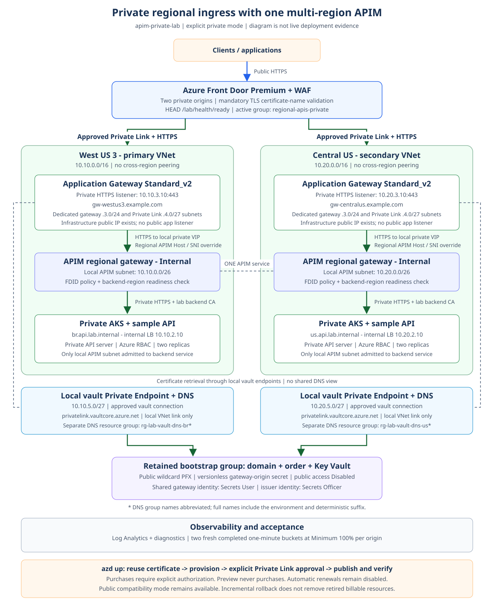

# Architecture diagrams

All labels, descriptions, and documentation are in English. SVG files are the
editable sources; matching PNG files are rendered exports for sharing.
The current documented environment is `apim-private-lab`, with West US 3 as
primary and Central US as secondary. Bicep's public compatibility default
has not changed.

Domain names use reserved `example.com` placeholders, not live endpoints.
Environment names are examples; create or select your own Azure environment.

## Reproduce PNG exports

Install Node.js 24 or newer, then run from the project root:

```powershell
npm ci
npm run diagrams
npm run diagrams:check
npm run test:diagrams
```

The renderer uses the lockfile-pinned `@resvg/resvg-js` package and bundled
Noto Sans Regular/Bold fonts, with system fonts disabled. No browser, Azure
login, or network access is needed after `npm ci`. Commit both SVG edits and
regenerated PNGs. Check mode fails on missing or stale PNGs without writing
files; CI checks byte-for-byte output on Windows and Linux.

The unmodified fonts come from
[notofonts/noto-fonts](https://github.com/notofonts/noto-fonts/tree/ffebf8c1ee449e544955a7e813c54f9b73848eac/hinted/ttf/NotoSans)
at commit `ffebf8c1ee449e544955a7e813c54f9b73848eac` and retain their
[SIL Open Font License 1.1](fonts/OFL.txt), separate from the code's MIT license.

## Current private model

| Diagram | Vector source | PNG export | Scope |
|---|---|---|---|
| Private ingress and certificate retrieval | [SVG](private-ingress.svg) | [PNG](private-ingress.png) | Front Door, approved Private Link, two gateways, one Internal APIM, private AKS, isolated regional vault endpoints/DNS |
| Deployment lifecycle | [SVG](deployment-workflow.svg) | [PNG](deployment-workflow.png) | Certificate reuse/purchase gates, read-only preview, azd hooks, explicit approval and publication |
| Failover and recovery design | [SVG](private-failover.svg) | [PNG](private-failover.png) | Application traffic versus test control, one-region disruption, restoration and fresh evidence |



The drawings represent configuration and test contracts, not proof by
themselves. The runbook records the November 5 private deployment readiness,
API, strict regional metric checks and the later
[November 5 measured private failover runs](../README.md#measured-private-path-failover)
separately. The drawings are not screenshots or evidence of those executions.
Azure preview, actual approvals, certificate
retrieval, workload rollout and fresh runtime evidence remain distinct gates.

### Reading the architecture

- **Public entry:** clients use Front Door Premium with WAF. The public
  wildcard certificate belongs to the regional gateway origin names, not an
  automatically configured client custom domain.
- **Private application path:** approved Front Door managed Private Link
  reaches each gateway's private HTTPS listener, then the local Internal
  APIM VIP and local AKS internal Load Balancer. APIM is one classic Premium
  service with two regional gateways, not two independent services.
- **Certificate path:** a shared user-assigned gateway identity has Secrets
  User at the retained vault. Each region has a local vault Private Endpoint
  and its own `privatelink.vaultcore.azure.net` zone, linked only to the local
  VNet. The two zones live in separate auxiliary resource groups.
- **Isolation:** no inter-region VNet peering or shared vault DNS view. Vault
  public access stays Disabled. Application Gateway infrastructure public IPs
  exist without public application listeners; AKS still has outbound access.
- **Certificate bootstrap:** the domain, public DNS, paid wildcard order and
  vault are retained in a separate bootstrap resource group. Issuer Secrets
  Officer and gateway Secrets User are distinct grants. Reuse needs no new
  purchase; creation requires explicit consent and authorization.
- **Control path:** Azure CLI / AKS Run Command publishes and tests workloads
  without exposing the private Kubernetes API server. It is not application
  request traffic. Temporary Kubernetes administrator access is optional.
- **Evidence:** per-origin readiness traverses the full private path and
  checks gateway/backend locality. Each origin requires two fresh completed
  one-minute buckets at Minimum 100%, not historical public-origin metrics.

## Public compatibility and historical evidence

| Diagram | Vector source | PNG export | Boundary |
|---|---|---|---|
| Restricted public APIM origins | [SVG](public-origins.svg) | [PNG](public-origins.png) | Original template-default conceptual model; Brazil South / East US examples |
| Historical public failover | [SVG](historical-public-failover.svg) | [PNG](historical-public-failover.png) | Actual November 3, 2026 public-mode run in the retired `apim-west-lab` |

The restored historical failover drawing is a reconstruction from the runbook,
not an original captured screenshot or a new test. It retains the documented
environment name and measured results. Those timings are not private-path evidence,
exact RTO measurements, or a production guarantee. Conceptual data/dependency
boxes in the public-mode drawing are not resources deployed by this lab.

## Operational boundaries

1. Preview does not purchase, start compute, or create infrastructure. Missing
   or pending certificates stop preview; finish an approved bootstrap first.
2. `azd up` can bootstrap through `preup`; `preprovision` remains read-only
   against Azure for bootstrap and AKS/gateway power state. `StartResources`
   is an explicit opt-in on Prepare-Lab, Provision-Lab and Test-Readiness, not
   an automatic action in tests. Publication and test preflights verify
   operational gateways, AKS/node pools, APIM/routing and private access;
   workload gates additionally verify actual nodes, replicas, ILB and endpoints.
3. Front Door Private Link owner approval is explicit. The deterministic
   `apim-lab:<ARM-guid-of-lowercase-profile-ID>` marker is 45 characters,
   not an authentication credential. Helpers recognize legacy markers too.
   If Front Door omits its approval status, helpers can use the distinct
   `ApprovedAtGateway` state only with an exact successful origin and a unique
   scoped `Succeeded/Approved` connection; the evidence source is explicitly
   reported. This is not a health check, and explicit Front Door rejection
   is never overridden.
4. A failed hook or an incremental mode change does not remove resources or
   stop charges. Preserve occupied subnets during rollback and inspect all
   three lab resource groups and external-vault assignments during cleanup.
5. Paid domain/certificate auto-renewals remain disabled. Annual product
   pricing does not imply a 360-day leaf certificate or unattended coverage.

For commands, prerequisites, cost warnings, and troubleshooting, use the
[project runbook](../README.md).
